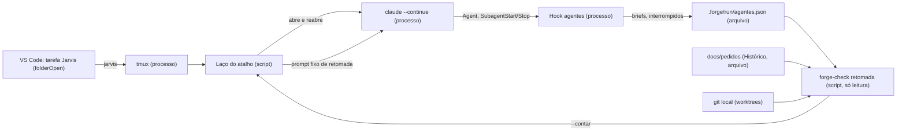

# Como o Jarvis sobrevive à queda da sessão e retoma sozinho os agentes? (BP3, desenho)

Propósito: desenhar a BP3 de `boas-praticas-1911.md` (sessão durável), sem código: o Jarvis roda sempre em `tmux`, no atalho e no modelo de projeto, inclusive para quem usa pelo VS Code; ao voltar, retoma sozinho os agentes interrompidos a partir de um registro por item, com os mesmos briefs selados. Público: dono, Jarvis, `tech-lead`, `devops-engineer`, o backend da stack, `qa-engineer`, `security-engineer`. Revisão: 2026-11-19.

Estado: proposta (pedido v0478, E39.1). Afrouxa: não (nenhum texto de `docs/regras/`, item de `tests/config.json` ou controle sai ou troca; o registro novo nunca recusa nem libera disparo, e o relançamento passa pelo R-TETO e pelo R-BRIEF como hoje).

Marcas: **[DOC]** confirmado no código do Forge (arquivo e linha citados) ou na documentação do Claude Code; **[INF]** inferência que o item de implementação prova com o oráculo indicado.

## 1. O problema, com os números do estudo

- **Fato:** 3 quedas da sessão em 30 h no Forge (16 a 19/11), uma por causa diferente: VPN caiu, VS Code desconectou, processo morreu. Em todas, os agentes em voo se perderam e a retomada foi manual (fonte: `boas-praticas-1911.md`, Diagnóstico 1 e linha BP3).
- **Efeito:** as paradas, e não as entregas, são o que mais rouba tempo; a BP3 está no grupo "agora, estabilidade" (BP1, BP2, BP3), porque sem ela nenhuma meta de minutos se sustenta.

| Causa da queda | O que morre hoje | O que segura com este desenho |
|---|---|---|
| VPN ou SSH caiu | o terminal; sem `tmux`, o `claude` e os agentes junto | `tmux`: o processo segue vivo; ao voltar, `jarvis` reanexa |
| VS Code desconectou (janela fechada, servidor remoto encerrado) | o terminal integrado e os filhos dele; com `shutdownAction` padrão, o próprio container [INF] | `tmux` + container que não para ao fechar o VS Code (seção 3.2) |
| Processo `claude` morreu (OOM, falha, `kill`) | a sessão e os subagentes em segundo plano | laço supervisor no `tmux` reabre com `--continue`, e o registro por item retoma os agentes (seções 3.1 e 4) |
| Container recriado ou máquina reiniciada | tudo o que está em memória | registro por item em disco persistente; retomada na próxima abertura (seção 4) |

## 2. O que já existe e por que não basta (evidência)

| Existente | O que faz | Por que não basta |
|---|---|---|
| `scripts/jarvis` e `scripts/jarvis-forge` com `tmux new-session -A` [DOC: `scripts/jarvis:43-46`, `scripts/jarvis-forge:219-224`] | abre o Jarvis num `tmux` por projeto e reanexa | Só quando a pessoa usa o atalho num terminal. No VS Code (painel da extensão ou terminal integrado sem o atalho) não há `tmux`, e foi lá uma das 3 quedas. `--sem-tmux` e a falta do `tmux` abrem sem aviso. Quando o `claude` sai, a janela do `tmux` fecha: nada reabre. |
| `--continue` no atalho [DOC: `scripts/jarvis:48`] | reabre a conversa | Os subagentes em segundo plano morreram com o processo e ninguém os relança; o `agent_id` deles só está no transcript. |
| Registro de agentes `.forge/run/agentes.json` (hook `agentes`, R-TETO) [DOC: `hooks/agentes.py:18-22`, `:338-354`] | guarda, por agente, tipo, descrição, branches, PID e sessão | Com a sessão morta, `vigentes()` descarta o registro na hora e a próxima gravação o apaga: a informação de quem estava em voo some exatamente quando seria útil. O registro não guarda o caminho nem o hash do brief, só as branches [DOC: `hooks/agentes.py:1104-1105`]. |
| Lápides e `autores` (H2) [DOC: `hooks/agentes.py:34-49`] | o autor parado pode ser retomado por `SendMessage` | Só para agente que terminou com `SubagentStop` ou foi liberado por notificação terminal; a queda do processo não gera nenhum dos dois. |
| Especificação do diário (`docs/retomada-de-sessao.md`, vigente desde 12/10) | diário append-only, hooks de sessão, skill `retomada` | Nunca implementada: não há `forge-diario`, `forge-retomada`, `forge_estado.py` nem hook de diário no `hooks/hooks.json` [DOC: busca no repositório, só a entrada do CHANGELOG da proposta]. É grande (6 hooks, 2 CLIs, skill) e repete o que o `agentes.json` já registra. |
| `forge-check pausa --gravar/--retomar` [DOC: `bin/forge_dono.py:431`] | onde parou na pausa por limite de uso | Gravado à mão pelo Jarvis antes de parar; uma queda não avisa antes. |

Evidência de execução: as 3 quedas do estudo, com retomada manual em todas. Este desenho não rodou comando (etapa sem código e sem shell nesta sessão); cada lacuna acima ganha, no item que a fecha, um teste que a reproduz antes do conserto (seção 7, oráculos).

## 3. Desenho: sessão durável

### 3.1 Atalho (`scripts/jarvis`, `scripts/jarvis-forge`)

1. **`tmux` por padrão, como hoje**, e sem `tmux` instalado: uma linha de aviso com o comando de instalação (`sudo apt-get install tmux`, ou o do sistema) e abre assim mesmo. `--sem-tmux` continua, com a linha "sessão não durável: uma queda do terminal derruba os agentes".
2. **Laço supervisor dentro do `tmux`.** O comando que roda na janela deixa de ser o `claude` direto e passa a ser o próprio atalho num modo interno, que roda o `claude` e, quando ele sai:
   - saída normal (código 0, `/exit`) ou interrupção pela pessoa (130): fim, a janela fecha como hoje;
   - saída anormal (morte por sinal, código 128 ou mais, fora 129 e 130) [INF: códigos do `claude` na queda; oráculo do item S1]: espera 10 s e reabre com `--continue` e o prompt inicial de retomada (3.3);
   - teto: 3 reaberturas em 30 min; passou disso, para, deixa a janela aberta com a linha "o Jarvis caiu 3 vezes em 30 min; veja `<registro>`" e não tenta mais.
   - cada queda e cada reabertura vira uma linha em `quedas.log`, na pasta de estado do Forge (`${XDG_STATE_HOME:-~/.local/state}/forge/`, que no container fica em disco persistente pelo `preparar-estacao`/`preparar-ambiente`), com data, projeto, código de saída e número da tentativa. Só isso: nada de saída do `claude`.
3. **Nada muda** no `--permission-mode auto`, no sandbox, no `--remote-control`, no canal do Telegram nem no `forge-sempre-atual` (que segue sem rodar sob sessão aberta).

### 3.2 Modelo de projeto, container e VS Code

| Onde | Mudança | Por quê |
|---|---|---|
| `templates/projeto/.vscode/tasks.json` (novo) | tarefa "Jarvis" que roda `jarvis` num terminal dedicado, com `runOptions.runOn: folderOpen` | Ao abrir ou reconectar a pasta no VS Code, o terminal anexa à sessão `tmux` que já existe (`new-session -A`) ou a cria. O VS Code pede uma vez a permissão de tarefas automáticas e respeita a confiança do workspace [DOC: VS Code]. |
| `templates/projeto/.devcontainer/devcontainer.json` e `.devcontainer/devcontainer.json` do Forge | `"shutdownAction": "none"` | Fechar a janela do VS Code não para o container, então o servidor `tmux` e o Jarvis seguem [INF: o padrão para container por imagem é parar; em Codespaces a chave é ignorada e vale o tempo ocioso do serviço]. |
| `templates/projeto/.devcontainer/preparar-ambiente.sh` | instala `tmux` pelo `apt` do sistema se faltar (sem chave nova) e o `--verificar` lista `falta: tmux` | O Forge já faz isso no `preparar-estacao.sh` [DOC: `docs/retomada-de-sessao.md`, seção 10]; o modelo de projeto não faz. |
| `bin/forge-init` | nada: ele já copia o modelo sem sobrescrever [DOC: `bin/forge-init:4`] | Projeto novo ganha o `.vscode/tasks.json`; projeto com `.vscode/tasks.json` próprio fica como está e o doutor diz como juntar. |
| Painel da extensão do VS Code | não roda em `tmux` (o processo é da extensão) | Fica para perguntas laterais; o Jarvis do projeto roda no terminal da tarefa. O aviso de 3.4 diz isso a quem abrir o Jarvis no painel. |

### 3.3 Prompt inicial de retomada

O `SessionStart` só põe contexto; o modelo não age sem um turno [DOC: hooks]. Para a retomada ser sozinha, quem abre a sessão manda o primeiro turno:
- O atalho consulta `forge-check retomada --contar` (só leitura, sem rede, até 3 s). Com 1 ou mais itens, abre o `claude` com o prompt fixo "Retomada automática (Forge): rode `forge-check retomada` e siga a matriz antes de qualquer trabalho novo." [INF: `--continue` com prompt posicional abre interativo; oráculo do item S5 com um `claude` falso no `PATH`]. Sem itens, abre como hoje.
- O texto é fixo no atalho: nenhum dado do registro entra no prompt (defesa contra injeção, como na seção 9.3 da especificação do diário).

### 3.4 Aviso fora do `tmux`

No `SessionStart` do `forge:jarvis`, sem `TMUX` no ambiente da sessão, o hook `doutor` acrescenta uma linha: "sessão fora do tmux: uma queda do terminal derruba os agentes; abra com `jarvis` (no VS Code, a tarefa Jarvis)". Só avisa, nunca bloqueia, uma vez por abertura.

## 4. Desenho: registro por item e retomada

### 4.1 Onde fica: no `agentes.json`, que já existe

Nenhum arquivo, diário ou hook novo de estado. O hook `agentes` ganha:

1. **`briefs` na reserva:** em cada disparo, além de `branches`, grava `[{"caminho": "docs/briefs/<nome>.md", "sha256": "<64 hex>"}]` dos briefs selados já lidos pelo R-BRIEF (`lidos`). Só caminho relativo e hash; nunca texto do prompt.
2. **Lista `interrompidos`** (teto 64, como `lapides`): quando um registro sai por sessão provadamente morta (`sessao_morta`, mesmo namespace, PID inexistente) e tem `briefs`, ele não some: vai para `interrompidos` com `id` (ou nulo, se a reserva nunca começou), `tipo`, `descricao`, `branches`, `escrita`, `briefs`, `sessao`, `desde` e `caiu_em`. A transição acontece sob a trava que já existe, na próxima gravação do estado.
3. **Fechamento** (o item sai de `interrompidos`):
   - relançamento do mesmo `tipo` com um brief de mesmo caminho (o hash pode ter mudado se o brief foi reselado);
   - retomada por `SendMessage` do mesmo `id` (o caminho H2 já existente, `reservar_retomada`);
   - prazo de `expiracao_horas`, sem retomada (vira linha em `liberacoes.log` com o motivo "interrompido vencido").
   Ninguém remove à mão: o Jarvis não edita o registro de agentes (decisão do dono de 2026-11-19 08:28).
4. **O que não entra:** agente parado por `TaskStop` ou com notificação terminal (`killed`, `failed`, `completed`): esse já tem lápide e não é retomado sozinho; conferente e tipos só de leitura.

`.forge/run/` fica no disco do projeto (`/workspaces` no container) e, no clone do Forge, no diretório comum do git dentro de `~/.forge-contrib`, também persistente [DOC: `hooks/agentes.py:18-19`]. Sobrevive à recriação do container.

### 4.2 `forge-check retomada` (só leitura)

Lê `interrompidos`, o `## Histórico` do pedido de cada brief e o git local; não grava nada, sem rede, com prazo por chamada de git (3 s). Uma linha por item:

| Situação | Ação que a linha manda |
|---|---|
| A sessão atual é a mesma conversa (`--continue`) e o transcript do subagente existe | `SendMessage` ao `id`: o agente continua com o próprio contexto [DOC: retomar subagente depois de reiniciar, retomando a mesma sessão] |
| Sem transcript, brief com selo válido | relançar `forge:<tipo>` com o mesmo brief e a nota "continue do estado atual da branch (`git log`, `git status`), confira antes de seguir" |
| Selo vencido (brief mudou ou base andou) | reselar (`forge-check brief selar`) e relançar; o aviso D3 do hook segue valendo |
| `entrega conferida` já registrada para a branch depois de `desde` | nada a relançar: o item foi entregue antes da queda; a linha diz isso |
| Worktree com arquivo não commitado | nunca descartar; relançar na mesma worktree, como acima |
| Qualquer remoção (worktree, branch, mudança) | não faz; pergunta ao dono (P2 de 2026-10-12: autônomo, exceto o destrutivo) |

Saídas: sem opção, as linhas; `--contar`, só o número (para o atalho); código 0 sempre que leu, 2 para argumento inválido, 4 para registro ilegível (que o atalho trata como zero e avisa).

### 4.3 O Jarvis

Uma frase em `agents/jarvis.md` e uma em `skills/trabalho-em-paralelo/SKILL.md` (Anda sozinho): "Na abertura com agentes interrompidos, `forge-check retomada` e a ação de cada linha antes de qualquer disparo novo; o destrutivo pergunta." O relançamento passa pelo teto, pelo duplicado, pela branch ocupada e pelo selo do brief como qualquer disparo.

### 4.4 Relação com a especificação do diário

O registro por item cobre a parte "delegação em voo" de `docs/retomada-de-sessao.md`, com uma fração do mecanismo. Ficam fora desta BP3, como estão: operação transitória interrompida (mutação de teste), decisões pendentes no diário, eventos de PR e CI. O item S6 marca a especificação como "substituída em parte por esta proposta" (decisão D5).

## 5. Fluxo

Legenda: o tipo de cada caixa está no rótulo; as setas dizem quem chama ou lê.

Alternativa em lista

- VS Code (tarefa ao abrir a pasta) ou terminal -> `jarvis` -> `tmux`.
- `tmux` -> laço do atalho -> `claude --continue`; saída anormal reabre, até 3 vezes em 30 min.
- `claude` -> hook `agentes` -> `agentes.json`: reserva com briefs; sessão morta vira `interrompidos`.
- `forge-check retomada` lê `agentes.json`, o Histórico do pedido e o git; o atalho usa `--contar`.
- Com itens, o atalho abre o `claude` com o prompt fixo de retomada; o Jarvis segue as linhas.

## 6. Riscos

| Risco | Mitigação |
|---|---|
| Laço de reabertura com uma falha que se repete (gasta cota de uso; R-CUSTO não, é a assinatura, mas consome limite) | teto de 3 em 30 min, pausa de 10 s, parada visível e `quedas.log` |
| Reabertura sem ninguém olhando, em modo automático, relança agentes | é o mesmo poder da sessão aberta; o relançamento passa por R-TETO e R-BRIEF; o destrutivo segue perguntando; parecer do `security-engineer` antes do código (gatilho: hook e atalho que reabre sessão) |
| Dois Jarvis no mesmo projeto (tarefa do VS Code e terminal) | `tmux new-session -A` anexa à mesma sessão; o nome é por projeto [DOC: `scripts/jarvis:23`] |
| `runOn: folderOpen` executa ao abrir uma pasta clonada | a tarefa vem do modelo do próprio projeto; o VS Code exige confiança no workspace e permissão de tarefas automáticas (pede uma vez) |
| Container que não para ao fechar o VS Code consome memória da máquina | só local, sem custo em dinheiro; o dono decide (D2); em Codespaces a chave não vale |
| Falso "interrompido": PID reaproveitado por outro processo | `sessao_morta` só dá verdadeiro com `ProcessLookupError`; PID reaproveitado parece vivo e o registro segue no prazo (falha para o lado seguro) [DOC: `hooks/agentes.py:304-317`] |
| Brief relançado depois de entregue (relançamento duplicado) | `forge-check retomada` confere `entrega conferida` no Histórico; o R-TETO recusa a segunda escrita na mesma branch |
| `--continue` com prompt posicional pode não abrir interativo em toda versão do `claude` [INF] | oráculo com `claude` falso no item S5 e teste manual na primeira queda real; sem suporte, o atalho cai no aviso do `SessionStart` (3.4) e a pessoa digita "retome" |
| Sandbox do Bash não alcança o socket do `tmux` (SBX-02) | nada do desenho roda `tmux` de dentro do agente; só o atalho, fora do sandbox |
| Achados recorrentes (PA-7) | AR-5: todo `python3` do atalho com `-I`; AR-3: os códigos de saída que reabrem são lista positiva; AR-1: lista de mutantes de cada ramo novo do hook; AR-4: testes com ambiente limpo (`TMUX`, `XDG_STATE_HOME`) |

## 7. Critério de parada

- bloqueia: nada; o registro de interrompidos e o `forge-check retomada` nunca recusam nem liberam disparo (R-TETO e R-BRIEF seguem como estão).
- interrompido-por-sessao-morta · registro com `briefs` cuja sessão está provadamente morta vai para `interrompidos` em vez de sumir · oráculo: `tests/test_agentes_interrompidos.py` (PID de processo filho já encerrado, mesmo namespace)
- fechado-por-retomada · relançamento com o mesmo caminho de brief, `SendMessage` ao mesmo `id` ou prazo vencido tiram o item · oráculo: `tests/test_agentes_interrompidos.py`
- nunca-texto-do-prompt · nenhum byte do prompt entra no `agentes.json` além de caminho e hash do brief · oráculo: `tests/test_agentes_interrompidos.py` (prompt com marcador único, procurado no arquivo)
- acao-por-situacao · cada linha da tabela 4.2 sai para o caso dela · oráculo: `tests/test_forge_check_retomada.py`
- reabre-so-na-queda · o laço reabre em 137 e não reabre em 0 nem 130; para na quarta queda em 30 min · oráculo: `tests/test_atalho_duravel.py` com `claude` falso no `PATH`
- gatilho · oráculo: `tests/test_queda_ponta_a_ponta.py` (registro com agente de sessão morta, `forge-check retomada --contar` = 1, atalho com `claude` falso recebe `--continue` e o prompt fixo)

## 8. Corte em itens (até 150 linhas de código e 10 arquivos cada)

| Item | Agente | Arquivos | Linhas de código (estim.) | Depende de |
|---|---|---|---|---|
| S1 atalho durável: aviso sem `tmux` e com `--sem-tmux`, laço supervisor, `quedas.log` | `devops-engineer` | `scripts/jarvis`, `scripts/jarvis-forge`, `tests/test_atalho_duravel.py`, `README.md`, `changelog.d/<branch>.md` | ~110 | — |
| S2 modelo e container: `.vscode/tasks.json`, `shutdownAction`, `tmux` no preparo | `devops-engineer` | `templates/projeto/.vscode/tasks.json`, `templates/projeto/.devcontainer/devcontainer.json`, `templates/projeto/.devcontainer/preparar-ambiente.sh`, `.devcontainer/devcontainer.json`, `tests/test_forge.py` (ou teste do modelo), `changelog.d/<branch>.md` | ~50 | D2, D3 |
| S3 registro por item: `briefs` na reserva, `interrompidos`, fechamento | backend da stack | `hooks/agentes.py`, `tests/test_agentes_interrompidos.py`, `tests/mutantes/<item>.json`, `changelog.d/<branch>.md` | ~120 | — |
| S4 `forge-check retomada` | backend da stack | `bin/forge_retomada.py` (módulo novo, para não crescer o `forge-check`), `bin/forge-check` (registro do subcomando), `tests/test_forge_check_retomada.py`, `tests/mutantes/<item>.json`, `changelog.d/<branch>.md` | ~140 | S3 |
| S5 prompt inicial de retomada e aviso fora do `tmux` | `devops-engineer` (atalho) e o backend da stack (hook) no mesmo branch, um depois do outro | `scripts/jarvis`, `scripts/jarvis-forge`, `hooks/doutor.py`, `tests/test_atalho_duravel.py`, `tests/test_doutor.py`, `changelog.d/<branch>.md` | ~60 | S1, S4 |
| S6 texto: Jarvis, skill, especificação do diário, invariante | `software-architect` | `agents/jarvis.md`, `skills/trabalho-em-paralelo/SKILL.md`, `docs/retomada-de-sessao.md`, `tests/config.json`, `changelog.d/<branch>.md` | 0 (texto) | S4, D5 |
| S7 queda de ponta a ponta, sem IA | `qa-engineer` | `tests/test_queda_ponta_a_ponta.py` | 0 (teste) | S3, S4, S5 |

Paralelo: S1, S2 e S3 juntos (sem arquivo comum); S4 depois de S3; S5 depois de S1 e S4; S6 e S7 por último, em paralelo. Pareceres por item: `tech-lead` em todos; `security-engineer` em S1, S3, S4, S5 (hook, atalho que reabre sessão em modo automático) e S2 (tarefa automática do VS Code, container); `qa-engineer` em todos.

Corte por arquivo (lote por arquivo, skill `trabalho-em-paralelo`):

| Arquivo | Itens | Ordem |
|---|---|---|
| `scripts/jarvis`, `scripts/jarvis-forge` | S1, S5 | S1 antes; S5 sobre a develop com S1 |
| `hooks/agentes.py` | S3 | — |
| `bin/forge-check`, `bin/forge_retomada.py` | S4 | — |
| `hooks/doutor.py` | S5 | — |
| `templates/projeto/**`, `.devcontainer/devcontainer.json` | S2 | — |
| `tests/test_atalho_duravel.py` | S1, S5 | S1 cria, S5 acrescenta |
| `agents/jarvis.md`, `skills/trabalho-em-paralelo/SKILL.md`, `docs/retomada-de-sessao.md`, `tests/config.json` | S6 | — |

## 9. Decisões do dono (a de maior peso primeiro, com recomendação)

1. **D1. Reabrir o Jarvis sozinho depois de uma queda do processo e retomar os agentes sem esperar um "ok".** A sessão volta em modo automático, sem ninguém olhando, e relança agentes com os briefs selados. Recomendação: **sim**, com o teto de 3 reaberturas em 30 min, só em saída anormal, e o destrutivo sempre perguntando (é a P2 de 2026-10-12 aplicada à reabertura). Reabre se: o `quedas.log` mostrar o teto de 3 atingido em dois dias da mesma semana, ou uma ação destrutiva acontecer sem confirmação.
2. **D2. Container que não para ao fechar o VS Code** (`shutdownAction: none`) no modelo de projeto e no container do Forge. Recomendação: **sim**; é a única forma de o `tmux` sobreviver a "VS Code desconectado" num container local, e não custa dinheiro. Reabre se: uma pessoa relatar falta de memória na máquina por container esquecido ligado.
3. **D3. Tarefa do VS Code que abre o Jarvis ao abrir a pasta** (`runOn: folderOpen`), em vez de só um perfil de terminal que a pessoa escolhe. Recomendação: **tarefa automática**; o VS Code pede a permissão uma vez e reconectar já reanexa. Reabre se: alguém relatar Jarvis aberto sem querer ou a tarefa recusada pela confiança do workspace em mais de um projeto.
4. **D4. Fora do `tmux` (painel da extensão, `--sem-tmux`): avisar ou bloquear.** Recomendação: **avisar** numa linha ao abrir, nunca bloquear (a extensão é escolha legítima para perguntas laterais). Reabre se: uma nova queda perder agentes numa sessão que recebeu o aviso.
5. **D5. A especificação do diário (`docs/retomada-de-sessao.md`) fica "substituída em parte"** por este registro por item (só delegações); operação transitória, decisões pendentes e eventos de PR/CI seguem não implementados. Recomendação: **sim**. Reabre se: uma queda deixar uma operação transitória (mutação de teste, rebase) sem desfazer.

## 10. Neutralidade e custo

- **R-NEUTRO:** nada de nome de projeto, stack ou regra de negócio. O `tmux`, a tarefa do VS Code, o `shutdownAction` e o registro valem para todo projeto do modelo; o nome da sessão `tmux` já vem da pasta [DOC: `scripts/jarvis:22-23`].
- **R-CUSTO:** nada pago. `tmux` vem do `apt` do sistema; testes com `claude` falso no `PATH` e biblioteca padrão; nenhuma chamada de API. A reabertura usa a assinatura da pessoa como a sessão de hoje, limitada pelo teto de D1.
- **Versão:** melhoria compatível (minor) quando chegar à `main`; cada item leva o seu fragmento em `changelog.d/`.
