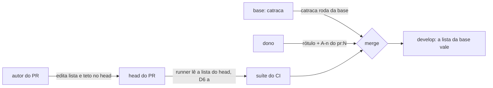

# Modelo de ameaças: quarentena de teste (BP1, Q0) e costura do relógio

Pedido v0478, etapa E37.43; volta do review (A1 e A2 de `docs/reviews/v0479-bp1-q0-ameacas.md`) na E37.48. Desenho: `docs/propostas/v0479-bp1-quarentena.md` (branch `melhoria/v0479-estabilidade-bp`). As decisões do dono de 20/11 valem (BP1 D2 a D8). Na D6 = a, o runner lê a lista no head do PR e a catraca barra o merge sem rótulo e sem autorização. Regras: `R-CONFORMIDADE`, `R-SEGURANCA`, `R-DECISAO`, `R-TETO`, `R-REVIEW`. Autorização por PR: ADR 0018. Revisão estática: nada foi explorado.
Gatilhos: autorizacao, ci-cd, controles-do-forge.

## 1. Ativos e fronteiras
- **A1** o portão de teste: o que a suíte do CI prova antes do merge na `develop`.
- **A2** `tests/quarentena.json` (a lista), `teto_pulados` e `teto_quarentena` (`tests/config.json`): o único meio legítimo de um teste sair do portão.
- **A3** a decisão do dono (`A-<n>`, ADR 0018): um OK por teste e por PR.
- **A4** o vigia de prazo dos hooks (`hooks/_comum.py`: `executar`, `vigia_de_prazo`, `estender_prazo`), que decide recusar ou liberar ação crítica.

Fronteiras:
- **F1** o autor escreve o head: a lista, os tetos e os scripts do runner.
- **F2** o que o head não escreve: a catraca da base, o rótulo e a autorização do dono.
- **F3** a data do runner.
- **F4** o processo de teste × o processo real do hook.

## 2. Quem escreve a lista (adulteração, elevação de privilégio)
Na D6 = a o PR de quarentena fica **verde** na parte: o runner do head já exclui o teste. Quem impede o afrouxamento é só a catraca (F2). Ela é o controle único, e o modo de falha dela decide tudo.

| ID | Ameaça (quem, de onde, o que ganha) | Sev. | Mitigação exigida |
|---|---|---|---|
| T1 | O autor põe entrada no head para o próprio teste instável (ou vermelho de verdade) passar sem OK | alta | **M1.1** a catraca (modo `pareceres`, da base) barra entrada nova, alterada ou prorrogada sem o rótulo `afrouxa-regra` e sem declaração da ADR 0018 que cubra o PR (`pr:<N>` do próprio PR). **M1.2** a catraca é check obrigatório do merge; o verde do runner nunca a substitui |
| T2 | Rótulo posto, e o autor empurra entrada a mais depois | alta | **M2.1** `tests/quarentena.json` entra nos vigiados do rótulo (`VIGIADOS_DO_ROTULO`, `tests/catraca.py:1130`): mudou depois do rótulo, ele deixa de valer (P9) |
| T3 | Reuso de `A-<n>` de outro PR ou de outra entrada; alvo genérico (a autorização permanente de rótulo não cobre) | alta | **M3.1** a catraca confere o ato, o alvo `pr:<N>` igual ao PR e o `A-<n>` único por entrada e por prorrogação; um teste por PR |
| T4 | Lista malformada no head (JSON inválido, chave duplicada, tipo errado, arquivo enorme, link simbólico) para a catraca falhar aberta e o runner ler outra coisa | média | **M4.1** catraca e runner usam o mesmo leitor puro (Q1) e falham fechados: na dúvida o runner não exclui nada e a catraca barra (nunca "sem entrada, nada a ver"). **M4.2** link simbólico, caminho fora de `tests/` e tamanho acima de um teto fixo são recusados |
| T5 | Id que exclui mais que um teste (módulo ou classe inteira, curinga, prefixo, substring de `-k`) | alta | **M5.1** `teste` é `modulo.Classe.metodo` literal e igual, por igualdade exata, ao id descoberto; sem curinga, prefixo nem regex. Id inexistente é rejeitado, não ignorado |
| T6 | Um agente ou script grava a lista (o `propor` da Q4 escreve a entrada) | média | **M6.1** `forge-check quarentena propor` só prepara a branch e pergunta; não grava autorização nem rótulo (ADR 0018). A lista só vale mesclada por PR com M1.1 |
| T7 | O autor muda o runner do head (`scripts/suite-*.py`) para ler a lista de outro lugar ou ignorar o teto | alta | **M7.1** a catraca e o teto de pulados do agregador rodam da base; os scripts do runner seguem protegidos (`R-CONFORMIDADE`). Teste da Q2 prova que o total de pulados do agregador conta a quarentena |

## 3. Teto: +1 por entrada, no máximo 3 (D2)
| ID | Ameaça | Sev. | Mitigação exigida |
|---|---|---|---|
| T8 | Subir `teto_pulados` além das entradas novas (folga para outro pulo), ou subir `teto_quarentena` | alta | **M8.1** `teto_pulados` sobe no máximo o número de entradas novas do PR (estende `regra_teto_pulados`, `tests/catraca.py:747`); `teto_quarentena` só cai sem rótulo e, com rótulo, não passa de 3 sem decisão nova do dono |
| T9 | Troca no mesmo PR: sai uma entrada, entra outra, saldo zero, sem OK ou com o OK da que saiu | média | **M9.1** entrada nova pede rótulo e `A-<n>` próprio mesmo com saldo zero; entrada removida exige queda do teto na mesma medida |
| T10 | Entrada com id inexistente, repetido ou já pulado por `skip` no código: ocupa o teto sem excluir nada, ou conta duas vezes e esconde um pulo | média | **M10.1** id único, existente no discover e sem `skip` no código; o total de pulados do agregador é a soma e nunca fica abaixo dos pulados do código |
| T11 | Entrada vencida fica no arquivo e o teto elevado sobra como folga | baixa | **M11.1** regra do dono: a vencida sai sozinha das ativas (D3) e o teto é +1 por entrada **ativa**, no máximo 3 (D2). A catraca barra, em todo PR, `teto_pulados` maior que os pulados fixos mais as entradas ativas na data do runner (vencidas **fora** da conta), e `teto_quarentena` vale para as ativas. Com isso o PR de remoção é obrigatório: enquanto a vencida e o teto elevado ficam, nenhum PR passa, salvo o que tira a vencida e desce o teto, que não pede rótulo (só aperta; corpus de S8). O aviso de 2 dias (M16.3) dá tempo de abrir esse PR antes de travar a fila |
| T12 | Teste em quarentena apagado, renomeado ou sem o `def` (some do discover e a lista "cobre" o nada) | média | **M12.1** a regra de testes no CI (I7b) e a catraca barram: o teste nunca é apagado; renomear exige entrada nova com o OK |

## 4. Prazo, prorrogação (D3) e data do runner (F3)
| ID | Ameaça | Sev. | Mitigação exigida |
|---|---|---|---|
| T13 | `prazo` além de `desde` + 7 dias, ou `desde` no futuro para alongar o prazo | alta | **M13.1** o leitor valida `desde` <= hoje (UTC do runner) e `prazo` <= `desde` + 7 dias, com data em formato estrito; entrada fora disso é inválida (falha fechada, M4.1) |
| T14 | Prorrogação sem OK, mais de uma, ou prazo novo sem limite | alta | **M14.1** a prorrogação é campo próprio (`prorrogado_ate`, com outro `A-<n>` e o `pr:<N>` do PR que a faz), no máximo uma, até 7 dias depois do prazo antigo; alterar prazo é entrada alterada (M1.1). O desenho não tem esse campo: o Q1 o acrescenta |
| T15 | Data do runner forjada por variável de ambiente, argumento ou arquivo para a entrada nunca vencer | alta | **M15.1** a data vem de função injetável só em teste: nenhuma variável `FORGE_*`, argumento ou arquivo a troca no CI (mesmo princípio da costura, seção 5). Desvio do relógio do runner fica limitado pelo teto de 7 dias |
| T16 | Entrada vencida continua excluída (falha aberta), ou o job informativo vira o único que roda o teste e ninguém olha | média | **M16.1** a vencida volta ao portão sozinha, sem ação humana. **M16.2** o job `quarentena (informativa)` fica fora de todo `needs` e não segura nem libera merge. **M16.3** a que vence em 2 dias aparece no `forge-check proximo` |
| T17 | A quarentena vira depósito (defeito real escondido) | média | prova de falha e verde na mesma árvore; teto de 3; prazo; cartão obrigatório; reversão da seção 8 do desenho |

## 5. Costura do relógio (integrada pelo #712; F4)
Evidência lida: `hooks/_comum.py:2866` (`relogio` e `armar` só por palavra-chave, padrão real), `tests/test_hooks_volta_corpus.py:127` (AST: hooks reais e driver do lote não os passam, nem por `**`) e `:150` (apelido do import e módulo com apelido).

| ID | Ameaça | Sev. | Estado |
|---|---|---|---|
| T18 | Variável de ambiente, argumento, arquivo ou a entrada JSON do hook liga o relógio falso e o hook libera fora do prazo | alta | mitigada: o hook lê só o stdin e usa o padrão real; nenhum caminho de entrada chega a `relogio`/`armar` (`_comum.py:2880`) |
| T19 | Um hook ou o driver passa `relogio`/`armar` | alta | mitigada pela AST (`test_hooks_reais_e_driver_nao_passam_relogio_nem_armar`) |
| T20 | Chamada ao `executar` de `_comum` fora de `hooks/` (o acesso dinâmico dentro de `hooks/` e do driver já é reprovado: reatribuição, `getattr`, `importlib`, `partial` e atributo solto, `tests/test_hooks_volta_corpus.py:176` e `:202`) | baixa | **M20.1 (recomendada, vira cartão)**: estender a varredura de `:202` aos scripts Python de `bin/` e `scripts/` (com e sem `.py`, pelo shebang) que importam `_comum`; o `.executar` só conta quando a base é `_comum` ou o nome vem dele, com corpus de legítimos que passa (`modulo_do_bin(...).executar`, `bin/forge-check:6813`, e os `def executar` de `bin/forge_meta.py:27` e `bin/forge-testes:643`); sonda S11 |
| T21 | Relógio falso no teste diverge do sinal real e dá falso verde | baixa | mantida a prova real na direção robusta (desenho 4.2) |

## 6. Casos de abuso (o `qa-engineer` os escreve como teste na implementação)
| Caso | Entrada | Caminho | Esperado |
|---|---|---|---|
| C1 | entrada nova, sem rótulo | head do PR → catraca | barra (T1) |
| C2 | entrada nova, com rótulo mas sem declaração `pr:<N>` deste PR | catraca | barra (T3) |
| C3 | `A-<n>` de outro PR, ou o mesmo `A-<n>` em duas entradas | catraca | barra (T3) |
| C4 | rótulo posto, depois um commit altera a lista | P9 | o rótulo deixa de valer (T2) |
| C5 | JSON inválido, chave duplicada, tipo errado, link simbólico | catraca e runner | a catraca barra; o runner não exclui nada (T4) |
| C6 | `teste` = módulo, classe, prefixo, curinga ou id inexistente | leitor | inválido; nada é excluído (T5, T10) |
| C7 | `teto_pulados` sobe além das entradas novas, ou `teto_quarentena` sobe | catraca | barra (T8) |
| C8 | 4.a entrada ativa simultânea | catraca e leitor | barra (T8) |
| C9 | uma entrada sai e outra entra, mesmo teto | catraca | barra sem rótulo e `A-<n>` novo (T9) |
| C10 | entrada sai e o teto não desce | catraca | barra (T9) |
| C11 | entrada vencida presente, teto ainda elevado (vencida fora da conta de ativas) | catraca | barra todo PR salvo o que tira a vencida e desce o teto, que passa sem rótulo (T11, M11.1) |
| C12 | `prazo` > `desde` + 7 dias; `desde` no futuro | leitor | inválida (T13) |
| C13 | segunda prorrogação, prorrogação sem `A-<n>` novo, ou além de +7 dias | catraca e leitor | barra (T14) |
| C14 | `FORGE_*` com data, argumento ou arquivo de data | runner | ignorado; vale a data do runner (T15) |
| C15 | entrada vencida | runner | o teste roda e reprova como qualquer outro (T16) |
| C16 | `def` do teste em quarentena removido | catraca e I7b | barra (T12) |
| C17 | `relogio=`/`armar=` no `__main__` de um hook, no driver, por `**` ou por `getattr` | AST | reprova (T19; já coberto em `tests/test_hooks_volta_corpus.py:127` e `:202`) |

## 7. Sondas que Q1, Q2 e Q3 devem passar
Entrega de controle: o autor executa cada sonda e o parecer registra o comando e o resultado. Cada etapa do desenho cita no texto dela os casos Cn que lhe cabem, e o parecer da etapa confere essa lista: Q1 (leitor) C5, C6 e C12, mais a parte do leitor de C8 e C13; Q2 (runner) C14 e C15; Q3 (catraca) C1 a C4, C7 a C11, C13 e C16; o cartão de M20.1 o T20.
- **Q1 (leitor)**: C5, C6 e C12 como casos de teste do leitor puro, cada um inválido pelo motivo certo e com mutante do ramo de falha.
- **Q2 (runner)**
  - S1 · lista ilegível, entrada sem campo ou com id inexistente: o total de testes rodados é o do discover, com aviso (C5, C6).
  - S2 · 4 entradas ativas, ou pulados da quarentena mais os do código acima de `teto_pulados`: a parte e o agregador reprovam (C7, C8).
  - S3 · entrada vencida (data falsa injetada, nunca por ambiente): o teste está no plano e roda (C15).
  - S4 · id parecido (prefixo, outra classe com o mesmo método): só o id exato é excluído (C6).
  - S5 · a guarda de completude conta o id em quarentena como coberto e pulado, não como ausente.
  - S6 · `FORGE_*` com outra data: sem efeito no CI (C14).
- **Q3 (catraca)**
  - S7 · C1 a C4 e C9 a C11 como casos de teste, cada um com mutante do ramo de falha (AR-1 e AR-2 de `docs/engineering/achados-recorrentes.md`).
  - S8 · C5, C7, C8, C12 e C13 reprovam pelo motivo certo; o corpus de legítimos passa: PR sem a lista, PR que só remove entrada com queda de teto (inclusive a vencida, C11), PR de quarentena com rótulo e `A-<n>` do PR.
  - S9 · C16 (I7b e catraca). C17 já é coberto pela AST (seção 5); a extensão de T20 sai no cartão de M20.1 (S11).
  - S10 · a catraca roda da base e o leitor da lista é o mesmo do runner (uma fonte só, sem leitor paralelo).
- **Cartão de M20.1**
  - S11 · um script de `bin/` que faz `from _comum import executar` e passa `relogio=` reprova; `modulo_do_bin("x").executar(a)` passa.

## 8. Riscos aceitos e limites
- Nenhum risco aceito proposto. A D6 = a deixa o PR de quarentena verde antes do merge: é a escolha do dono; o risco vira T1 a T3 e depende de M1.2 (catraca obrigatória).
- Fora do escopo: a fila de merge (BP2) e a conversão dos testes de tempo (Q9.n).
- Ferramentas: nenhuma varredura nova (revisão só de leitura). Parecer de segurança nos itens Q3, Q6 e Q9, conforme o corte do desenho.
