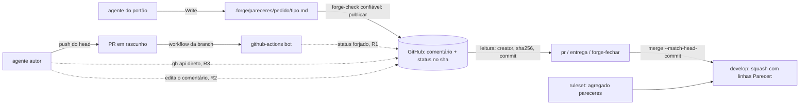

# Modelo de ameaças: parecer como status do commit (G2)

Pedido v0481, etapa E6.7 (G2.0, segunda parte). Parte do modelo da branch `melhoria/v0480-g2-0-adr-status` (pedido v0478, E101.2; sem PR, nunca entrou na `develop`), refeito sobre a `develop` 30dde218 com as linhas conferidas de novo. Desenho: `docs/propostas/g1-g3-fluxo-rapido.md`, seção 3 (Riscos R1 a R5) e linha G2.0 da seção 5. Decisão: ADR 0019 (`docs/adr/0019-parecer-como-status.md`, proposta, branch `melhoria/v0481-g2-0-adr-status`, #872); ela passa a `vigente` só depois deste modelo. Contas e token: desenho do G4 (`docs/propostas/g4-trava-real-bp8.md`), T5, T7, T13 e passo 3. Regras: `R-SEGURANCA`, `R-REVIEW`, `R-QA`, `R-MAIN`, `R-CONFORMIDADE`, `R-DECISAO`, `R-CUSTO`. Revisão estática: nada foi explorado e nenhuma API foi chamada.
Gatilhos: controles-do-forge, autorizacao, ci-cd, segredos.

## 0. Os três riscos do pedido e onde ficam
| Risco do pedido | No desenho | Ameaças | Mitigações | Testes (seção 3) |
|---|---|---|---|---|
| **R1** status forjado por workflow com o `GITHUB_TOKEN` | R1 | T1, T2, T3, T13 | M1.1 a M1.4, M2.1, M3.1 a M3.3, M13.1 | C1 a C4, C19 |
| **R2** comentário editado depois do status | seção 3, "Quem lê" | T5 a T8, T15, T16 | M5.1 a M5.3, M6.1, M7.1, M8.1, M15.1, M15.2, M16.1 | C6 a C10, C16, C20, C22 |
| **R3** autoria do papel (mesma conta; código da branch publicando) | R2 e R3 | T4, T9, T10, T18 | M4.1, M4.2, M9.1 a M9.3, M10.1, M18.1 | C5, C11, C12, C21, C23 |

O resto (herança, token, disponibilidade, transição) vem do desenho (R4, R5) e da ADR 0019, seção 1.4, e fica nas seções 2.5 a 2.8.

## 1. Ativos, atores e fronteiras
- **A1** o veredito de cada portão no head do PR: os statuses `parecer-review`, `parecer-qa`, `parecer-seguranca`, `parecer-devops` e o agregado `pareceres`.
- **A2** o texto do parecer: o comentário do PR apontado pelo `target_url`, preso ao status pelo sha256 da descrição.
- **A3** a autoria do papel: `.forge/run/autoria.jsonl`, gravado pelo hook (`hooks/conformidade.py:3956-3973`) e lido pelo `forge-check` (`bin/forge-check:1389-1395`).
- **A4** o código que publica e lê: `bin/forge_pareceres.py` (novo), `bin/forge-check` (`parecer publicar`, `parecer herdar`, `pr`, `entrega`), `bin/forge-fechar`.
- **A5** a trilha depois do merge: as linhas `Parecer:` no corpo do squash na `develop`.
- **A6** o token do GitHub da sessão (`GH_TOKEN`) e a proteção da `develop` e da `homolog` (ruleset com o agregado, pendência D3 a) do dono).

Atores: (1) o agente autor, com o mesmo token dos portões; (2) um agente guiado por texto injetado (corpo de PR, comentário, saída de ferramenta); (3) o código do autor, executado por quem confia nele; (4) o workflow do PR com o `GITHUB_TOKEN` (`github-actions[bot]`); (5) outra conta com acesso ao repositório.

Estado de hoje, conferido: nenhum workflow pede `statuses: write` (`.github/workflows/ci.yml:27-28`, todo job com `contents: read` e no máximo `actions`, `checks` ou `pull-requests` de leitura; `catraca.yml:10-11` e `:22-25`; `release.yml:11` e `:52-53`, só `contents: write` na tag) e nenhum usa `secrets.`. Para R1 acontecer, o PR precisa editar o workflow; no `pull_request` de branch do mesmo repositório, o GitHub roda o workflow da própria branch.

Fronteiras:
- **F1** a cópia do autor × a cópia do portão (código da branch nunca roda como ferramenta do portão).
- **F2** a sessão (token) × o GitHub (o que o servidor guarda: `creator`, hora, histórico de edição).
- **F3** o workflow do PR (`GITHUB_TOKEN`) × os statuses de parecer.
- **F4** a ferramenta (`publicar`, `herdar`) × o Bash do agente (`gh api`, `gh pr comment`).
- **F5** o PR aberto × a `develop` depois do squash.

## 2. Ameaças, mitigação, reversão e lacuna
Severidade pelo efeito: merge na `develop` sem o portão que a classe exige. Toda mitigação é requisito dos itens G2.1 a G2.4; o ID (`M<n>.<m>`) é o que o parecer de cada item cita, e a seção 3 diz o teste que a prova.

### 2.1 Status forjado (R1; S, T)
| ID | Ameaça (quem, de onde, o que ganha) | Sev. | Mitigação exigida | Reversão | Lacuna |
|---|---|---|---|---|---|
| T1 | O PR edita o próprio workflow, pede `statuses: write` e grava `parecer-review` `success` com o `GITHUB_TOKEN` | alta | **M1.1** a leitura aceita só status com `creator.login` na lista positiva (AR-3); `github-actions[bot]`, qualquer `[bot]` e qualquer outra conta ficam fora, mesmo com o contexto certo. **M1.2** o filtro vem antes da escolha do mais novo: status de fora da lista não esconde nem substitui o da conta (sem negação de serviço por status mais novo do bot). **M1.3** nenhum workflow usa segredo com token da conta dos agentes: um PAT dela num workflow faria o `creator` passar por M1.1; a catraca barra mudança em `.github/workflows/` (`PROTEGIDOS`, `tests/catraca.py:47`). **M1.4** a lista positiva é lida de configuração da base (arquivo em `PROTEGIDOS`, extraído da `origin/develop` como em M10.1), não de `gh api user` no momento da leitura: com outro `GH_TOKEN` no ambiente, a conta desse token não vira aprovadora; `gh api user` diferente da lista falha fechada em `publicar` | status com `creator` fora da lista aceito por `pr`, `entrega` ou `forge-fechar` (ADR 0019, "Critério de reversão") | a proteção do servidor não filtra `creator`: ver T3 |
| T2 | Contexto parecido aceito: `Parecer-review`, `parecer-review ` com espaço, `parecer/review`, `ci/parecer-review` ou contexto novo | média | **M2.1** a lista de contextos é fechada e a comparação é igualdade exata de bytes; fora dela, ignorado na leitura e recusado na escrita. A lista só cresce por ADR (ADR 0019, seção 2) | contexto fora da lista contado no agregado | nenhuma |
| T3 | O bot (T1) grava o agregado `pareceres` `success`: o ruleset da D3 a) aceita o status mais novo do contexto, de qualquer fonte, e o merge pela interface ou pela API passa | alta | **M3.1** o `forge-fechar` não confia no agregado: relê cada contexto exigido pela leitura de M1 a M8 no sha e só então mescla preso ao head. **M3.2** o hook `parecer` segue decidindo pelo resultado gravado do `pr` antes de `gh pr merge` (`hooks/parecer.py:836`, `verificar`). **M3.3** o passo 12 do G4 confere se o ruleset aceita fixar a fonte do contexto `pareceres`; se aceitar, fixa | merge com agregado verde e contexto exigido inválido pela leitura | **até o G4, passo 3** (token sem `workflow`): enquanto o token envia workflow, o PR pode reescrever o `ci.yml` e forjar qualquer check, inclusive a catraca (G4, T5). O G2 não piora: o job `pareceres` de hoje cai pelo mesmo caminho |
| T13 | Agregado verde sem recalcular, ou recalculado com a lista de exigidos da branch | alta | **M13.1** o agregado é recalculado a cada `publicar` e `herdar`, sobre `exigidos_do_pr` da ferramenta confiável (`bin/forge-check:1828`) e com os gatilhos do diff do head; exigido ausente, `pending`, `failure` ou inválido pela leitura deixa `pending` | agregado `success` com exigido faltando | ver T3 |

### 2.2 Comentário editado depois do status (R2; T, R)
| ID | Ameaça | Sev. | Mitigação exigida | Reversão | Lacuna |
|---|---|---|---|---|---|
| T5 | O comentário é editado ou apagado depois do status: o veredito fica `success` e o texto passa a dizer outra coisa, ou some | alta | **M5.1** a leitura busca o comentário pela API (`repos/{o}/{r}/issues/comments/{id}`), calcula o sha256 do corpo e compara com a descrição; diferente, apagado ou ilegível: o parecer não vale (falha fechada). **M5.2** o autor do comentário (`user.login`) está na lista de M1.1. **M5.3** o `publicar` calcula o sha256 sobre o corpo **devolvido pela API** depois do POST (relido por GET), não sobre o arquivo local, e falha fechada se ele difere do local pela mesma normalização (texto sem espaços nas pontas, como `hooks/conformidade.py:3965`; fim de linha `\r\n` → `\n`): sem isso, uma normalização do servidor invalidaria todo parecer legítimo | comentário adulterado aceito | comentário apagado bloqueia o merge (negação de serviço aceita: publica-se de novo) |
| T6 | `target_url` aponta para gist, página externa, comentário de outro PR ou de outro repositório, ou redireciona | média | **M6.1** a leitura nunca segue o `target_url`: extrai o id só do formato `https://github.com/<dono>/<repo>/pull/<n>#issuecomment-<id>`, com `<dono>/<repo>` iguais ao do remoto e `<n>` igual ao PR cujo head é o sha; o resto é inválido. A busca é pela API, sem rede fora do GitHub | `target_url` fora do formato aceito | nenhuma |
| T7 | sha256 truncado: com 12 hex (48 bits), um agente gera fora do caminho um texto com veredito trocado e o mesmo prefixo | baixa | **M7.1** sha256 inteiro (64 hex) na descrição e na linha `Parecer:`; a ferramenta conta os caracteres e falha fechada acima de 140. Acolhido no texto da ADR 0019, seção 2 | prefixo curto aceito | nenhuma |
| T8 | Comentário íntegro de outro sha reaproveitado: status no sha B aponta o comentário publicado para o sha A | média | **M8.1** o `commit:` do frontmatter do comentário é igual ao sha do status, ou, na herança, ao sha de origem da descrição (M12.1); `pedido` e `branch` batem com o PR; o veredito do texto bate com o estado e a descrição (`aprovado`/`riscos-aceitos` com `success`, `reprovado` com `failure`) | status aceito com `commit:` de outro sha | nenhuma |
| T15 | Depois do merge, o comentário é apagado ou o PR some, e a `develop` não guarda o texto | média | **M15.1** o `forge-fechar` só mescla com as linhas `Parecer: <contexto> <estado> <sha40> sha256 <64> <url>` montadas do resultado da leitura (nunca de texto livre), no `--body` do `gh pr merge --squash --match-head-commit`. **M15.2** `forge-check metricas` acusa commit da `develop` vindo de PR sem as linhas exigidas (merge feito fora do `forge-fechar`) | comentário sumido e squash sem `Parecer:` (ADR 0019, "Critério de reversão") | o git guarda o hash, que prova integridade e não reconstrói o texto; aceitável enquanto o GitHub guardar o histórico de edição |
| T16 | Linha `Parecer:` forjada pelo autor no corpo do PR ou numa mensagem de commit entra no squash | baixa | **M16.1** quem lê as linhas (`metricas`, `voltas`, `forge-placar`) aceita só as do commit de squash e só no bloco final que o `forge-fechar` escreve; confere o hash contra o comentário enquanto ele existir | linha forjada contada como parecer | linha cujo comentário já sumiu não se confere |

### 2.3 Autoria do papel e código que publica (R3; S, R, E)
| ID | Ameaça | Sev. | Mitigação exigida | Reversão | Lacuna |
|---|---|---|---|---|---|
| T4 | Status gravado direto pelo Bash (`gh api -X POST .../statuses/<sha>` e `gh pr comment` com corpo cujo sha256 bate), sem `publicar`: o `creator` é a mesma conta | alta | **M4.1** `publicar` registra cada publicação (sha, contexto, sha256 e id do comentário) em `pareceres-publicados.jsonl` da **pasta de controle**, uma só por máquina para todos os clones: no Forge, `~/.forge-contrib/.forge/run/` (a raiz dos pedidos, `RAIZES_DE_BRIEF`, `bin/forge-check:3940`); no projeto, o `.forge/run/` da cópia do projeto que contém `.forge/wt/`. Nunca o `.forge/run/` do clone (`raiz_principal`, `bin/forge-check:2340`, devolve o próprio clone: o portão publica no `-rev`, `-qa` ou `-sec` e o `forge-fechar` roda noutro). Uma função só da ferramenta confiável (M10.1) acha a pasta, sem seguir link e falhando fechada se não a acha; `pr` e `forge-fechar` recusam status de parecer sem o registro nela. O caminho do Forge ganha regra `quem: []` no `conformidade.json` no G2.1 (o `.forge/run/` de `hooks/conformidade.json:38` é o da raiz do repositório). O comentário do PR não serve de registro: o mesmo token o escreve pelo Bash, e o comentário já é conferido por M5. **M4.2** o hook `conformidade` barra `gh api` que grava em `statuses` ou em `issues/<n>/comments`, e `gh pr comment` com o marcador de parecer, com o `Corrigir` apontando `forge-check parecer publicar` | status aceito sem registro de `publicar` | M4.1 e M4.2 são [B] (mesma conta, mesmo sandbox). Fecha só com conta por papel, fora do G4 de hoje |
| T9 | O autor do código escreve o parecer do próprio PR e o publica no contexto de outro papel | alta | **M9.1** `publicar` exige, em `autoria.jsonl`, registro com o sha256 do texto local e o papel do tipo (review: `tech-lead`; QA: `qa`; segurança: `seguranca`; devops: `devops`); **sem o arquivo ou sem o registro, recusa** (o `pr` de hoje aceita a ausência do arquivo, `bin/forge-check:158-160`; o `publicar` não herda essa folga; ADR 0019, seção 3). **M9.2** o hook `autoria` passa a registrar `.forge/pareceres/` (hoje só `docs/{reviews,qa,devops,security}/`, `hooks/conformidade.py:3962-3968`), e o `conformidade.json` ganha a regra de caminho por papel para `.forge/pareceres/<pedido>/<tipo>.md` no G2.1, com o `quem` de hoje de cada tipo. **M9.3** o revisor do contexto é diferente do autor dos commits do PR, pela regra de hoje (`exigidos_do_pr`) | parecer publicado sem registro do papel | a autoria é local, a mesma força de hoje: prova o papel na máquina, não no GitHub. Fecha com conta por papel |
| T10 | O portão roda `bin/forge-check` ou `bin/forge_pareceres.py` da cópia da branch: o código do autor publica `success` ou pula a leitura | alta | **M10.1** a conferência de código confiável não mora no código que ela protege: o portão chama o `forge-check` do PATH (plugin carregado) ou uma extração de `origin/develop` em `$TMPDIR` rodada com `python3 -I` (AR-5), nunca `./bin/forge-check` da cópia; o hook `conformidade` barra `bin/forge-check parecer publicar` por caminho da cópia, com o `Corrigir` do comando certo. A extração (e a lista de M1.4) sai de `refs/remotes/origin/develop` só se o sha dela for igual ao de `git ls-remote origin refs/heads/develop`; diferente, falha fechada (ref local reescrita pelo agente não vale). Acolhido na ADR 0019, seção 3 | `publicar` executado de código diferente do da base | [B] até o G4: o agente roda qualquer Python com o token; o efeito fica limitado por M1 a M9, que valem em quem lê |
| T18 | Sessão de projeto (`R-CONTRIB`) publica status no Forge com o mesmo token | média | **M18.1** `publicar` confere que o remoto da cópia é o repositório do PR e que o PR é da `branch:` do texto; com o G4, passo 4, o token dos agentes fica só na sessão do Forge | status do Forge gravado por sessão de projeto | [B] até o passo 4 do G4 |

### 2.4 Herança indevida (T, E)
| ID | Ameaça | Sev. | Mitigação exigida | Reversão | Lacuna |
|---|---|---|---|---|---|
| T11 | `herdar` copia `failure`, copia contexto cujo domínio mudou, ou herda de sha não ancestral do head | alta | **M11.1** só `success`; só de sha ancestral do head; domínio pelo `commit_vale` do tipo (`bin/forge-check:904`), da ferramenta confiável (M10.1). **M11.2** o status de origem passa pela leitura inteira (M1, M5, M6, M8) antes de ser copiado: herdar não lava status forjado | herança de `failure`, domínio mudado ou não ancestral aceita | nenhuma |
| T12 | Cadeia A → B → C com o domínio medido de B para C | média | **M12.1** a descrição cita a origem real em 40 hex e o sha256 do texto (`herdado de <sha40> · sha256 <64>`); o domínio é medido sempre da origem ao head. Acolhido na ADR 0019, seções 1.4 e 2 | herança medida a partir de outro herdado | nenhuma |
| T14 | `riscos-aceitos` publicado como `success` sem o aceite do dono, ou com aceite de outro commit | alta | **M14.1** `publicar` com `parecer: riscos-aceitos` exige `docs/security/aceites/<pedido>.md` no head com `commit:` igual ao do parecer (`R-SEGURANCA`); o caminho segue `quem: []` (`hooks/conformidade.json:77`) | `success` de `riscos-aceitos` sem aceite | nenhuma |

### 2.5 Permissão do token (D3 b; E, I)
| ID | Ameaça | Sev. | Mitigação exigida | Reversão | Lacuna |
|---|---|---|---|---|---|
| T17 | A D3 b) amplia o token para gravar status e comentar; hoje o token é o clássico do dono, com `repo`, `workflow`, `admin:*` e `delete_repo` (G4, tabela a) | alta (herdada) | **M17.1** a permissão do G2 é a da lista do G4, passo 3 a, e nada além: Contents, Pull requests e Commit statuses **Read and write**; Actions, Checks, Issues e Metadata **Read**; nenhuma outra (sem Administration, Workflows, Secrets, Variables, Environments, Webhooks, Deployments). No clássico (G4, passo 3 b), só `public_repo`, com o limite real no papel `write` do passo 2. **M17.2** a D3 b) não se aplica dando escopo novo ao token do dono: ou o token já serve (hoje `repo` cobre status e comentário) ou vai à conta dos agentes do G4 | token com escopo além de M17.1 depois do G4 | até o G4, o token do dono serve ao G2 e a todo o resto; a lacuna é do G4, não nova |

### 2.6 Disponibilidade e transição (D; desenho R4 e R5)
| ID | Ameaça | Sev. | Mitigação exigida | Reversão | Lacuna |
|---|---|---|---|---|---|
| T19 | Sem `gh`, sem rede, API com erro, limite de taxa ou resposta paginada: a leitura vê lista vazia ou parcial e conclui "sem `failure`" | média | **M19.1** falha fechada em todo erro; a leitura percorre todas as páginas de `commits/{sha}/statuses` e trata resposta incompleta como erro | aprovado lido de resposta parcial | nenhuma |
| T20 | Transição: o `pr` lê arquivo e status; o autor escolhe o caminho mais fraco ou mistura os dois | média | **M20.1** por contexto, vale um caminho só: com status de parecer no head, o arquivo é ignorado; o arquivo vale só para branch com base anterior ao G2.2, e sai no G2.8 | parecer em arquivo aceito em branch nova | uma versão com os dois leitores |

## 3. O teste que prova cada mitigação
O `qa-engineer` escreve os casos como teste no item indicado (`qa-testing`, "Plano antecipado"); G2.1 a G2.4 são controle com gatilho, e a 1.ª rodada de cada um recebe da segurança o oráculo (`tests/test_oraculo_<pedido>.py`, EXT-1) tirado destes casos. A API do GitHub entra por dublê (`gh` falso no PATH, como nos testes do `forge-fechar`): nenhum teste chama a rede (`R-CUSTO`). Mitigação sem código no Forge é provada por leitura, com o comando.

| Mitigação | Caso | Teste (arquivo · nome) | Item |
|---|---|---|---|
| M1.1, M1.2 | C1, C2 | `tests/test_forge_pareceres.py` · `test_c1_status_do_bot_ignorado`, `test_c2_bot_mais_novo_nao_esconde_failure_da_conta` | G2.2 |
| M1.3 | — | `tests/test_catraca.py` (já cobre `.github/workflows/` em `PROTEGIDOS`) e, no G2.1, `test_nenhum_workflow_usa_secrets` lendo `.github/workflows/*.yml` | G2.1 |
| M1.4 | C19 | `test_c19_login_fora_da_lista_da_base` (leitura e `publicar` com `gh api user` diferente da lista) | G2.1, G2.2 |
| M2.1 | C3 | `test_c3_contexto_parecido` (leitura ignora, `publicar` recusa) | G2.1, G2.2 |
| M3.1, M13.1 | C4 | `tests/test_fechar_checks_exigidos.py` · `test_c4_agregado_verde_com_exigido_ausente`; `test_forge_pareceres.py` · `test_agregado_pending_com_exigido_invalido` | G2.1, G2.4 |
| M3.2 | — | `tests/test_pr_hook_rapido.py` · `test_reprovado_do_mesmo_head_recusa_so_lendo`, `test_aprovado_forjado_nao_libera_o_merge_s3` (os de hoje, seguem verdes) e, novo, `test_m32_merge_recusado_pelo_gravado_com_status_invalido` (o `pr` lê status forjado, grava reprovado e o hook recusa o `gh pr merge`) | G2.2 |
| M3.3 | — | leitura do dono: `gh api repos/{o}/{r}/rulesets/<id>` mostra a fonte do contexto `pareceres` (G4, passo 12) | G4 |
| M4.1 | C5 | `test_c5_status_sem_registro_de_publicar`, `test_c5_registro_so_no_run_do_clone_nao_vale`, `test_c5_pasta_de_controle_por_link_falha_fechada`, `test_c5_publicado_num_clone_lido_noutro` (corpus) | G2.1, G2.2 |
| M4.2, M10.1 (hook) | C12, C21 | `tests/test_conformidade_pareceres.py` · `test_c21_gh_api_statuses_barrado`, `test_c21_gh_pr_comment_com_marcador_barrado`, `test_c12_publicar_pela_copia_barrado` | G2.1 |
| M5.1, M5.2 | C6, C7 | `test_c6_comentario_editado`, `test_c6_comentario_apagado`, `test_c7_comentario_de_outra_conta` | G2.2 |
| M5.3 | C20 | `test_c20_corpo_devolvido_difere_do_local` (`publicar` falha fechada e não grava status) | G2.1 |
| M6.1 | C8 | `test_c8_target_url_fora_do_formato` (o dublê de rede falha o teste se a URL for seguida) | G2.2 |
| M7.1 | C9 | `test_c9_sha256_curto_ou_descricao_acima_de_140` | G2.1, G2.2 |
| M8.1 | C10 | `test_c10_commit_do_texto_diferente_do_sha`, `test_c10_veredito_diferente_do_estado` | G2.2 |
| M9.1, M9.3 | C11 | `test_c11_papel_autor_publica`, `test_c11_sem_autoria_jsonl_recusa` | G2.1 |
| M9.2 | C11 | `tests/test_conformidade_pareceres.py` · `test_autoria_registra_forge_pareceres`, `test_caminho_por_papel_em_forge_pareceres` | G2.1 |
| M10.1 (extração) | C12 | `test_c12_origin_develop_reescrito_localmente` | G2.1 |
| M11.1, M11.2 | C13 | `test_c13_herdar_failure`, `test_c13_herdar_dominio_mudado`, `test_c13_herdar_nao_ancestral`, `test_c13_herdar_status_forjado` | G2.3 |
| M12.1 | C14 | `test_c14_cadeia_mede_da_origem` | G2.3 |
| M14.1 | C15 | `test_c15_riscos_aceitos_sem_aceite`, `test_c15_aceite_de_outro_commit` | G2.1 |
| M15.1 | C16 | `tests/test_fechar_checks_exigidos.py` · `test_c16_squash_leva_linhas_parecer_da_leitura` | G2.4 |
| M15.2, M16.1 | C16, C22 | `test_c16_metricas_acusa_squash_sem_parecer`, `test_c22_linha_parecer_forjada_no_corpo` | G2.4 |
| M17.1, M17.2 | — | leitura do dono no G4: escopos do token (`gh auth status` mostra os do clássico; o fino, na página do token) | G4 |
| M18.1 | C23 | `test_c23_remoto_diferente_do_pr` | G2.1 |
| M19.1 | C17 | `test_c17_api_com_erro`, `test_c17_pagina_2_nao_lida`, `test_c17_sem_gh` | G2.2 |
| M20.1 | C18 | `test_c18_branch_nova_com_arquivo_sem_status` | G2.2 |

Prova de que o teste mata o que diz: cada nome acima entra na spec de mutantes do item (`forge-mutante`) com a troca que desliga a mitigação (por exemplo, M1.1 sem o filtro de `creator`; M5.1 sem a comparação do sha256); mutante vivo é bloqueante no QA do item.

## 4. Casos de abuso
| Caso | Entrada | Caminho | Esperado |
|---|---|---|---|
| C1 | status `parecer-review` `success` com `creator` `github-actions[bot]` | API → leitura (`pr`, `entrega`, `forge-fechar`) | ignorado; o contexto conta como ausente (T1) |
| C2 | status do bot mais novo que um `failure` da conta | leitura | vale o `failure` da conta (M1.2) |
| C3 | contexto `Parecer-review`, `parecer-review ` ou `ci/parecer-review` | leitura e `publicar` | ignorado na leitura, recusado na escrita (T2) |
| C4 | agregado `pareceres` `success` com `parecer-qa` exigido ausente | `forge-fechar` | não mescla e diz o que falta (T3, T13) |
| C5 | status da conta sem registro de `publicar` na pasta de controle; registro só no `.forge/run/` do clone; pasta de controle trocada por link | `pr`, `forge-fechar` | inválido nos três (T4) |
| C6 | comentário editado depois do status; comentário apagado | leitura | inválido nos dois (T5) |
| C7 | comentário de outra conta com o mesmo corpo | leitura | inválido (M5.2) |
| C8 | `target_url` de gist, de outro repositório, de outro PR ou sem `#issuecomment-` | leitura | inválido, sem acesso à URL (T6) |
| C9 | descrição com sha256 de 12 hex, ou acima de 140 caracteres | `publicar` e leitura | recusado (T7) |
| C10 | status no sha B apontando o comentário com `commit:` A; veredito do texto diferente do estado | leitura | inválido (T8) |
| C11 | parecer de review escrito pelo papel autor; `autoria.jsonl` ausente | `publicar` | recusa nos dois (T9) |
| C12 | `bin/forge-check parecer publicar` da cópia da branch; `refs/remotes/origin/develop` reescrito localmente | hook e `publicar` | barra com `Corrigir`; com a ref diferente do `ls-remote`, falha fechada (T10) |
| C13 | `herdar` de `failure`, de domínio mudado, de sha não ancestral, de status forjado (C1) | `herdar` | não copia (T11) |
| C14 | herança A → B → C com domínio mudado entre A e C e intacto entre B e C | `herdar` | não copia (T12) |
| C15 | `riscos-aceitos` sem aceite, ou com aceite de outro `commit:` | `publicar` | recusa (T14) |
| C16 | squash sem as linhas `Parecer:` exigidas | `forge-fechar`, `forge-check metricas` | o `forge-fechar` não monta squash sem elas; o `metricas` acusa o merge feito fora dele (T15) |
| C17 | API com erro, página 2 não lida, sem `gh` ou sem rede | leitura | falha fechada (T19) |
| C18 | branch nova com parecer em arquivo e sem status | `pr` | o arquivo não vale (T20) |
| C19 | `GH_TOKEN` de outra conta no ambiente; status dessa conta no head | leitura e `publicar` | a conta não está na lista da base: ignorado na leitura, recusa no `publicar` (M1.4) |
| C20 | o servidor devolve corpo diferente do enviado (fim de linha, caractere trocado) | `publicar` | falha fechada antes de gravar o status (M5.3) |
| C21 | `gh api -X POST repos/{o}/{r}/statuses/<sha>`; `gh pr comment` com o marcador de parecer | hook `conformidade` | barra com o `Corrigir` de `publicar` (M4.2) |
| C22 | corpo do PR ou mensagem de commit com `Parecer: parecer-review success ...` | `metricas`, `voltas`, `forge-placar` | só o bloco final escrito pelo `forge-fechar` conta (M16.1) |
| C23 | `publicar` numa cópia cujo remoto não é o repositório do PR | `publicar` | recusa (M18.1) |

Corpus de legítimos (deve passar): parecer aprovado da conta da lista, publicado pelo `publicar` confiável, comentário íntegro; parecer publicado no clone do portão (`<branch>-rev`) e lido pelo `forge-fechar` noutro clone da mesma máquina; `reprovado` seguido de `aprovado` no head novo; herança de `success` com domínio intacto desde a origem, inclusive a `develop` trazida sem tocar o domínio; `riscos-aceitos` com aceite do mesmo `commit:`; comentário com `\r\n` devolvido pela API e o mesmo texto normalizado; branch anterior ao G2.2 com parecer em arquivo. Um teste do corpus por item, junto dos casos.

## 5. Relação com a ADR 0019 (#872)
- Acolhidas no texto da ADR, que prevalece sobre o desenho: sha256 inteiro (M7.1, seção 2), origem da herança em 40 hex com o sha256 (M12.1, seções 1.4 e 2), código confiável fora do próprio `publicar` (M10.1, seção 3), `publicar` recusa sem `autoria.jsonl` (M9.1, seção 3), lista positiva de `creator` e falha fechada (M1.1, M5.1, M19.1, seção 3).
- A entrar por emenda, como a ADR prevê ("o que ele pedir entra aqui por emenda"): **E-1** a lista positiva vem de configuração da base, não de `gh api user` (M1.4); **E-2** o sha256 é do corpo devolvido pela API (M5.3); **E-3** o registro de cada publicação em `pareceres-publicados.jsonl` da pasta de controle da máquina (no Forge `~/.forge-contrib/.forge/run/`; no projeto, o `.forge/run/` da cópia que contém `.forge/wt/`; nunca o do clone) e o bloqueio de `gh api` em `statuses` e de `gh pr comment` com o marcador (M4.1, M4.2), que dão corpo ao "a leitura descarta o que não veio da ferramenta" da seção 3. Se o arquiteto não acolher, a divergência vira ADR com as duas posições.

## 6. Critério de reversão
O da ADR 0019 vale para o conjunto: um status forjado aceito pela leitura, ou um parecer perdido (comentário sumido com PR mesclado sem a linha `Parecer:`), devolve o Forge ao parecer commitado na branch. A coluna "Reversão" de cada ameaça é o evento que dispara esse critério; a leitura da ADR mede os dois (meta 0).

## 7. Medida que move
Este documento não move medida sozinho: ele é a condição para a ADR 0019 passar a `vigente` e para o G2.1 começar. A medida do G2 inteiro é **aprovação vencida** (rodada de portão disparada por head novo cujo delta deu `revalida: não`) e **tempo por item** (`lead_develop_h_p50` e `relogios:`), como na ADR 0019, "Medida que move". As mitigações foram escolhidas para não trazer a rodada de volta: a herança (M11, M12) roda na ferramenta, sem portão, e só falha fechada quando a leitura acha status inválido; nenhuma mitigação pede commit na branch.

## 8. Riscos aceitos e lacunas
- Nenhum risco aceito proposto.
- Lacunas que ficam: T3 e T10 até o G4, passo 3 (token sem `workflow`); T4, T9 e T18 enquanto todos os agentes usam uma conta só (a mesma força de hoje); T15, texto inteiro só no GitHub.
- Ferramentas: nenhuma varredura nova (revisão só de leitura). Parecer de segurança nos itens G2.1, G2.2, G2.3 e G2.4 (escrita, leitura, herança e merge) e no G2.5 (CI), conforme o corte do desenho.
