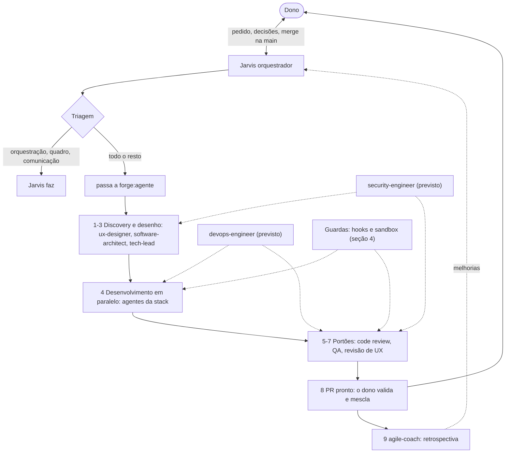
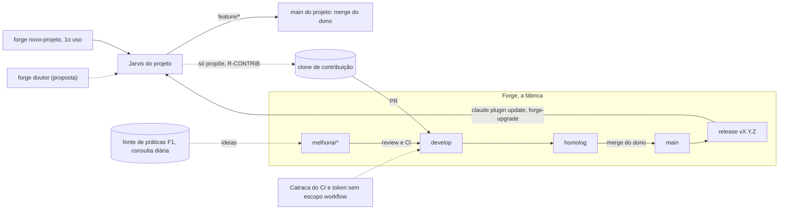

# Como o Forge funciona?

Propósito: dar a visão geral (big picture) da fábrica: quem faz o quê, em que ordem, que guardas vigiam o trabalho e como fábrica e projetos se integram. Público: dono do Forge, quem adota o Forge num projeto e agentes que precisam do contexto geral. Revisão: 2026-10-14.

O texto das regras e o papel de cada agente ficam nas fontes: [`agents/`](../agents/), [`agents/jarvis.md`](../agents/jarvis.md) ("Triagem de cada pedido", "Como conduzir um pedido"), [regras com ID](regras/README.md) e [ADRs](adr/README.md). Aqui só o mapa.

## 1. Fluxo de um pedido

### Do pedido à entrega (fluxo do Jarvis)

Legenda: retângulo = etapa ou agente; losango = decisão; arredondado = pessoa; tracejado = apoio ou vigilância; "(previsto)" = agente ainda não existe.

Alternativa em lista

- Dono -> Jarvis: pedido; Jarvis -> Dono: decisões (`R-DECISAO`) e PR para o merge.
- Jarvis -> Triagem: faz sozinho (orquestração) ou passa a `forge:<agente>`, dizendo qual e por quê.
- Agentes -> Discovery e desenho (`R-DISCOVERY`) -> Desenvolvimento -> Portões (`R-REVIEW`, `R-QA`) -> PR.
- Previstos: `security-engineer` entra no desenho e nos portões; `devops-engineer`, no desenvolvimento e nos portões.
- Hooks e sandbox vigiam o desenvolvimento e os portões; `agile-coach` devolve melhorias ao Jarvis.

## 2. Fábrica e projetos

### Integrações entre o Forge, os projetos e a fonte externa

Legenda: retângulo = etapa ou branch; cilindro = repositório ou fonte (externo); tracejado = consulta ou vigilância; seta cheia = fluxo de código.

Alternativa em lista

- `forge novo-projeto` -> Jarvis do projeto: cria o repositório e conduz o primeiro uso; o `forge doutor` (proposta) confere a instalação.
- Jarvis do projeto -> clone de contribuição -> PR na `develop` do Forge: o projeto só propõe (`R-CONTRIB`).
- Fonte F1 -> `melhoria/*`: ideias de prática, verificadas por dia ([fontes de práticas](fontes-de-praticas.md)).
- `melhoria/*` -> `develop` -> `homolog` -> `main` -> release (`R-FLUXO`, `R-MAIN`); a catraca e o token valem nos PRs.
- Release -> projetos: só a `main` do Forge chega a eles, por `claude plugin update` e `forge-upgrade`.

O Jarvis do Forge roda sobre uma cópia vigente da `develop`, não sobre a cópia em edição ([ADR 0009](adr/0009-conformidade-dos-agentes.md)).

## 3. O time

| Agente | Papel |
|---|---|
| Jarvis | Única interface com o dono: triagem, planejamento, delegação, quadro e resumo de entrega ao dono; não implementa |
| `ux-designer` | Design Thinking até o protótipo validado; revisão da interface pronta |
| `software-architect` | Arquitetura, modelo de dados, integrações, requisitos não funcionais, ADRs |
| `tech-lead` | Boas práticas, code review (`R-REVIEW`), versionamento, integração, release e PR |
| agentes da stack | Implementação, em `stacks/<stack>/agents/` (back-end e front-end do pacote) |
| `qa-engineer` | Plano de testes, E2E, acessibilidade, portão de QA (`R-QA`) |
| `agile-coach` | Quadro Kanban, métricas de fluxo, retrospectivas |
| `devops-engineer` (previsto) | CI/CD, containers, IaC, ambientes; review de infra |
| `security-engineer` (previsto) | Modelo de ameaças e review de segurança quando há gatilho |

## 4. Guardas

| Guarda | Onde age | O que garante |
|---|---|---|
| Hooks (`hooks/`, [guia](hooks.md)) | Em chamadas de ferramenta e em eventos de sessão e subagente | Papéis e caminhos (`conformidade`), pareceres antes do PR, teto e quadro, aviso do que escapou (`vigia`) |
| Catraca do CI (`tests/catraca.py`) | Em cada PR do Forge | Regras invioláveis, custo zero, neutralidade, pareceres; afrouxar exige o rótulo do dono |
| Sandbox do Bash ([README](../README.md#sandbox-do-bash)) | Em cada comando | Escrita só nas pastas de trabalho, credenciais ilegíveis, APIs de modelo negadas |
| Token da conta de máquina | No GitHub | Sem escopo `workflow`: workflows só o dono muda |

Regras por tema: [`R-MAIN`](regras/R-MAIN.md), [`R-FLUXO`](regras/R-FLUXO.md), [`R-CONTRIB`](regras/R-CONTRIB.md), [`R-CONFORMIDADE`](regras/R-CONFORMIDADE.md), [`R-CUSTO`](regras/R-CUSTO.md), [`R-NEUTRO`](regras/R-NEUTRO.md). Decisões: [0003 hooks](adr/0003-hooks-deterministicos-e-silenciosos.md), [0006 contribuição](adr/0006-contribuicao-de-qualquer-projeto.md), [0008 governança](adr/0008-governanca-de-contribuicoes.md), [0009 conformidade](adr/0009-conformidade-dos-agentes.md).
