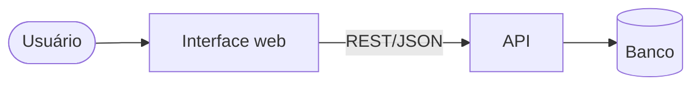

# Arquitetura de Software

## Arquitetura de referência (até haver motivo para mudar)
- Monólito modular, módulos por domínio; banco relacional com camada de acesso tipada (o projeto decide em ADR); comunicação entre camadas por contrato versionado.
- Estrutura, autenticação e organização do repositório da stack: `${CLAUDE_PLUGIN_ROOT}/stacks/<stack>/pronto.md`, seção "Arquitetura de referência" (a stack vem do `CLAUDE.md` do projeto).

## Visão geral (`docs/architecture/overview.md`)
Diagramas C4 nível 1 (contexto) e 2 (containers) em Mermaid:



## ADR (`docs/architecture/adr/NNNN-titulo.md`)
```markdown
# NNNN - Título da decisão
- Status: proposta | aceita | substituída por NNNN
- Data: AAAA-MM-DD

## Contexto
Qual problema ou força motivou a decisão.

## Decisão
O que foi decidido.

## Alternativas consideradas
Opção, prós, contras — para cada uma.

## Consequências
O que fica mais fácil, o que fica mais difícil, riscos.
```

## Plano técnico de feature (`docs/architecture/features/<feature>.md`)
1. Resumo e link para a especificação de UX.
2. Módulos afetados (back e front).
3. Mudanças no modelo de dados (entidades, relacionamentos, migrações).
4. Endpoints necessários em alto nível (o detalhe fica com o agente de back-end da stack).
5. Riscos, dependências e decisões em aberto.
6. Divisão de tarefas: agentes da stack do projeto e `qa-engineer`, com a ordem e o que pode rodar em paralelo.

## Modelo de dados (`docs/architecture/data-model.md`)
Diagrama ER em Mermaid (`erDiagram`) e, para cada entidade: campos, chaves, índices e regras de integridade.

## Checklist de requisitos não funcionais
- **Segurança:** autenticação, autorização por recurso, validação de entrada, segredos, OWASP Top 10.
- **Performance:** metas de latência (ex.: p95 < 300 ms), paginação, índices, cache quando justificado.
- **Escalabilidade:** API sem estado; jobs pesados em fila.
- **Observabilidade:** logs estruturados, correlation id por requisição, health check, métricas básicas.
- **Confiabilidade:** migrações reversíveis, backups, timeouts e retentativas em integrações externas.
- **Testabilidade:** fronteiras claras entre camadas, dependências injetáveis.
- **LGPD:** dados pessoais mapeados, mínimo necessário, possibilidade de exclusão.
